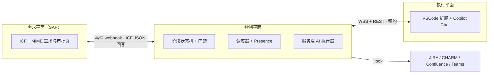

# SAP Super Agent

> 面向 SAP 研发交付的 super-agent：需求记录在 SAP，编排在控制平面，编码在开发者身边的 VSCode，重复的文档工作由服务端 AI 主动完成。

**状态：设计阶段（v0）。** 本仓库当前包含设计文档、调研材料与可交互演示；代码实现按 [路线图](docs/007-roadmap.md) 推进（H0 骨架进行中）。

**设计演示**：[demo/index.html](demo/index.html) — 10 幕 HTML 动画，浏览器打开即可（自动播放，支持 ← → / 空格 / 重播）。

## 为什么

SAP 研发交付的瓶颈通常不在编码，而在需求分析、开发说明、测试文档、跨系统流转这些重复劳动，以及"等人处理"造成的排队。现有流程（例如 PDO）已经能基于服务端 AI 生成部分文档，但仍是**人点一步、AI 做一步**，没有主动推进；开发上下文也不在开发者手边。

本项目参考 DeepSeek 的 super-agent 设计（Router/Worker 双层、事件驱动、订阅直通），但换了实现边界：

| | DeepSeek dsh-superagent | 本项目 |
| --- | --- | --- |
| 触发来源 | GitHub / 飞书 | SAP 内自建需求系统 |
| 主进程 | DSH 主 Session | 可移植编排核心：本地 / 独立服务 / SAP 受限宿主 |
| 执行者 | 服务端 DSH worker + worktree | 在线开发者的 VSCode 扩展（Copilot Chat）+ 服务端 AI 批处理 |
| 产物 | PR、评论 | 需求分析、开发说明、代码变更、测试文档、知识条目 |

## 架构一览



- **离线不派单，但不停工**：需要人的阶段只在人真正在线且工作区匹配时进入可领取池；服务端 AI 阶段 7×24 推进。
- **服务端 AI 走 BYOK**：企业自有模型 Key（OpenAI 兼容 / DeepSeek / Azure，自部署/安全协议），不绑定 Copilot 订阅；VSCode 内的 Copilot Chat 只负责人机协作开发。
- **SAP 端 ICF + MIME**：一个 ICF 节点同时提供 JSON API 与 SAP 内 Web 页面；认证走 SSO，v1 暂不建模细粒度权限。
- **MCP 可选**：v1.1 可把控制平面能力暴露为 MCP tools，供其他 AI 客户端复用。
- **授权先于自主**：每个阶段有明确门禁，AI 只做被授权的范围；所有状态变化进入不可变事件日志。
- **三个部署模式**：M1 本地一条命令、M2 团队独立服务、M3 SAP 受限宿主（需求/审批/AI 批处理在 SAP，交互式 agent 不在 ABAP）。

## 文档

按顺序阅读：

- [000 定位与原则](docs/000-vision.md)
- [001 对原始方案的审视与建议](docs/001-review.md)
- [002 总体架构](docs/002-architecture.md)
- [003 领域模型与协议](docs/003-domain-and-protocol.md)
- [004 SAP 侧设计](docs/004-sap.md)
- [005 客户端与服务端 AI](docs/005-clients-and-ai.md)
- [006 仓库结构与 Git 策略](docs/006-repo-and-git.md)
- [007 路线图](docs/007-roadmap.md)
- [008 Hook 契约](docs/008-hooks.md)
- [009 测试策略](docs/009-testing.md)
- 调研附录：[DeepSeek super-agent 文章](docs/reference/deepseek-superagent-paper.md)、[参考实现分析](docs/reference/prototype-analysis.md)、[技术可行性](docs/reference/stack-feasibility.md)、[PDO 流程映射](docs/reference/pdo-flow-review.md)
- 执行交接：[HANDOFF.md](HANDOFF.md) · 进度看板 [handoffs/STATUS.md](handoffs/STATUS.md)
- 原始需求简报：[docs/plan.md](docs/plan.md)

## 快速开始

前置：Node `^22.19.0 || >=24.0.0`（推荐 24）、pnpm 10（`corepack enable`）。

```sh
corepack enable
pnpm install
cp .env.example .env     # 可选；不配也能跑，默认 fake AI provider
pnpm dev                 # 启动 M1 控制平面（默认 http://127.0.0.1:3080）
```

`pnpm dev` 打印 control plane URL 与本地 dev token（user/admin）。控制平面启动时读取工作目录 `.env`（`SA_AI_*` / `SA_STATE_DIR` / `SA_HTTP_PORT`，真实环境变量优先）；同一状态目录只允许一个实例，重复启动会直接提示已占用。另开终端建需求：

```sh
TOKEN=<user token>
curl -s -X POST http://127.0.0.1:3080/api/v1/demands \
  -H "authorization: Bearer $TOKEN" -H 'content-type: application/json' \
  -d '{"title":"R-2041 取数逻辑","description":"按销售组织汇总开票金额","acceptanceCriteria":["金额与 MARA 一致"],"requester":{"userId":"REQ001"}}'
```

fake provider 下数秒内 `GET /api/v1/demands/{id}` 会包含 `requirement_analysis` 工件；S0 用 `POST /api/v1/admin/tasks` 手建开发任务（S1 起由模板自动产生）。

VSCode 扩展（任务客户端 + 本地能力宿主，不接管 Copilot 会话）：

1. VSCode 打开本仓库，`pnpm --filter sap-superagent-vscode run build` 后按 F5（或安装 VSIX）；
2. 命令面板 → `SAP Super Agent: 连接控制平面`，粘贴 `pnpm dev` 打印的 user token（存 `SecretStorage`）；
3. `绑定当前工作区` → 任务箱「可领取」领取任务 → `打开任务` 生成 `.sap-superagent/task/<taskId>/context.md`，供 Copilot Chat 用 `#file` 引用。

其他命令：

```sh
pnpm cli init --repo z-sales --project-key SALES   # 写 .sap-superagent/workspace.json
pnpm cli token --kind user                         # 单独签发 token
pnpm cli doctor                                    # 环境自检：Node/pnpm/端口/状态目录/模板/AI
```

端口被占用时用 `pnpm cli dev --port <port>`（例如 3080 已被别的应用占用）。

开发与验收门禁：

```sh
pnpm check        # typecheck + eslint + 单测/集成测试 + contracts 快照
pnpm e2e          # M1 纵向闭环 + docs/009 失败场景 #1/#2/#3/#10
pnpm build        # 所有包按依赖拓扑序构建（产物在 .gitignore 内）
pnpm contract:gen # 从 protocol 重新生成 contracts/json-schema 与 examples
```

服务端 AI 走 BYOK（OpenAI 兼容 / DeepSeek / Azure，Key 只在服务端）；无 Key 时默认 `fake` provider，e2e 与离线开发不依赖网络。配置项见 [.env.example](.env.example) 与 [docs/005](docs/005-clients-and-ai.md)。

## 参与

- 开发、分支、提交与 PR 约定见 [006 仓库结构与 Git 策略](docs/006-repo-and-git.md)；AI Agent 协作约定见 [AGENTS.md](AGENTS.md)。
- SAP 侧开发统一使用 [abap-cli](.agents/skills/abap-cli/SKILL.md)。
- 安全问题不要公开提交含真实系统 / 凭据 / 需求内容的信息；先通过仓库 Issue 模板联系维护者（SECURITY.md 随仓库初始化补充）。

## License

Apache-2.0（v1 决定；仓库初始化时加入 `LICENSE` 与 `NOTICE`，后者声明 abap-cli skills 等第三方来源）。贡献采用 DCO（`Signed-off-by`）。
