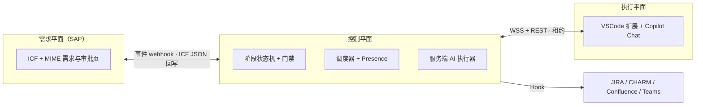

# SAP Super Agent

> 面向 SAP 研发交付的 super-agent：需求记录在 SAP，编排在控制平面，编码在开发者身边的 VSCode，重复的文档工作由服务端 AI 主动完成。

**状态：设计阶段（v0）。** 本仓库当前包含设计文档与调研材料，代码实现按 [路线图](docs/007-roadmap.md) 推进。

## 为什么

SAP 研发交付的瓶颈通常不在编码，而在需求分析、开发说明、测试文档、跨系统流转这些重复劳动，以及"等人处理"造成的排队。现有流程（例如 PDO）已经能基于服务端 AI 生成部分文档，但仍是**人点一步、AI 做一步**，没有主动推进；开发上下文也不在开发者手边。

本项目参考 DeepSeek 的 super-agent 设计（Router/Worker 双层、事件驱动、订阅直通），但换了实现边界：

| | DeepSeek dsh-superagent | 本项目 |
| --- | --- | --- |
| 触发来源 | GitHub / 飞书 | SAP 内自建需求系统 |
| 主进程 | DSH 主 Session | 可移植编排核心：本地 / 独立服务 / SAP 受限宿主 |
| 执行者 | 服务端 DSH worker + worktree | 在线开发者的 VSCode 扩展（Copilot Chat）+ 服务端 AI 批处理 |
| 产物 | PR、评论 | 需求分析、开发说明、代码变更、测试文档、知识条目 |

## 架构一览



- **离线不派单，但不停工**：需要人的阶段只在人真正在线且工作区匹配时进入可领取池；服务端 AI 阶段 7×24 推进。
- **服务端 AI 走 BYOK**：企业自有模型 Key（OpenAI 兼容 / DeepSeek / Azure，自部署/安全协议），不绑定 Copilot 订阅；VSCode 内的 Copilot Chat 只负责人机协作开发。
- **SAP 端 ICF + MIME**：一个 ICF 节点同时提供 JSON API 与 SAP 内 Web 页面；认证走 SSO，v1 暂不建模细粒度权限。
- **MCP 可选**：v1.1 可把控制平面能力暴露为 MCP tools，供其他 AI 客户端复用。
- **授权先于自主**：每个阶段有明确门禁，AI 只做被授权的范围；所有状态变化进入不可变事件日志。
- **三个部署模式**：M1 本地一条命令、M2 团队独立服务、M3 SAP 受限宿主（需求/审批/AI 批处理在 SAP，交互式 agent 不在 ABAP）。

## 文档

按顺序阅读：

- [000 定位与原则](docs/000-vision.md)
- [001 对原始方案的审视与建议](docs/001-review.md)
- [002 总体架构](docs/002-architecture.md)
- [003 领域模型与协议](docs/003-domain-and-protocol.md)
- [004 SAP 侧设计](docs/004-sap.md)
- [005 客户端与服务端 AI](docs/005-clients-and-ai.md)
- [006 仓库结构与 Git 策略](docs/006-repo-and-git.md)
- [007 路线图](docs/007-roadmap.md)
- [008 Hook 契约](docs/008-hooks.md)
- [009 测试策略](docs/009-testing.md)
- 调研附录：[DeepSeek super-agent 文章](docs/reference/deepseek-superagent-paper.md)、[参考实现分析](docs/reference/prototype-analysis.md)、[技术可行性](docs/reference/stack-feasibility.md)、[PDO 流程映射](docs/reference/pdo-flow-review.md)
- 执行交接：[HANDOFF.md](HANDOFF.md) · 进度看板 [handoffs/STATUS.md](handoffs/STATUS.md)
- 原始需求简报：[docs/plan.md](docs/plan.md)

## 快速开始

尚未发布可运行版本；实现从 [HANDOFF.md](HANDOFF.md) 开始（S0 骨架 → S1 门禁/模板 → S2 SAP）。路线图 v0.1.0 将提供：

```sh
npx sap-superagent dev          # M1 本地模式：控制平面 + 面板 + 内置 AI 执行器
```

VSCode 扩展将提供「连接控制平面 → 绑定工作区 → 领取任务 → 在 Copilot Chat 中处理」的最小闭环。

## 参与

- 开发、分支、提交与 PR 约定见 [006 仓库结构与 Git 策略](docs/006-repo-and-git.md)；AI Agent 协作约定见 [AGENTS.md](AGENTS.md)。
- SAP 侧开发统一使用 [abap-cli](.agents/skills/abap-cli/SKILL.md)。
- 安全问题不要公开提交含真实系统 / 凭据 / 需求内容的信息；先通过仓库 Issue 模板联系维护者（SECURITY.md 随仓库初始化补充）。

## License

Apache-2.0（v1 决定；仓库初始化时加入 `LICENSE` 与 `NOTICE`，后者声明 abap-cli skills 等第三方来源）。贡献采用 DCO（`Signed-off-by`）。
