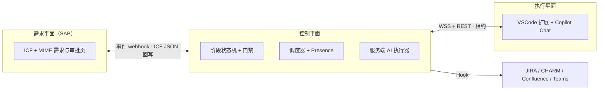

# SAP Super Agent

> 面向 SAP 研发交付的 super-agent：需求记录在 SAP，编排在控制平面，编码在开发者身边的 VSCode，重复的文档工作由服务端 AI 主动完成。

**状态：S0–S4、H2（SAP 需求系统）与 S5/M3 Phase A 已合入 `main`；S5 Phase B 的 SAP 侧可独立部分已完成（测试系统上 `ZCL_ZSA_AI_BATCH`/`ZSA_AI_BATCH_RUN` 已激活、ABAP Unit 15/15），端到端仍 blocked（缺控制平面可达/HMAC/服务账号、SM36、企业 AI 网关输入，见 [docs/010 §9.3](docs/010-m3-deployment.md#93-phase-b-人工输入清单blocked-判据)）。v1.0.0 发布物料已就绪（CHANGELOG、SECURITY/支持版本、版本号 1.0.0、VSIX 打包 `pnpm package:vsix`、真实 VSCode Extension Host 冒烟 `pnpm vscode:smoke`、离线文档链接检查 `pnpm link:check`），tag 待发布确认。** 代码按 [路线图](docs/007-roadmap.md) 推进；`pnpm check` / `pnpm e2e` / `pnpm build` / `pnpm sap:check` / `pnpm contract:check` / `pnpm link:check` 为当前验收命令。

**设计演示**：[demo/index.html](demo/index.html) — 10 幕 HTML 动画，浏览器打开即可（自动播放，支持 ← → / 空格 / 重播）。

## 为什么

SAP 研发交付的瓶颈通常不在编码，而在需求分析、开发说明、测试文档、跨系统流转这些重复劳动，以及"等人处理"造成的排队。现有流程（例如 PDO）已经能基于服务端 AI 生成部分文档，但仍是**人点一步、AI 做一步**，没有主动推进；开发上下文也不在开发者手边。

本项目参考 DeepSeek 的 super-agent 设计（Router/Worker 双层、事件驱动、订阅直通），但换了实现边界：

| | DeepSeek dsh-superagent | 本项目 |
| --- | --- | --- |
| 触发来源 | GitHub / 飞书 | SAP 内自建需求系统 |
| 主进程 | DSH 主 Session | 可移植编排核心：本地 / 独立服务 / SAP 受限宿主 |
| 执行者 | 服务端 DSH worker + worktree | 在线开发者的 VSCode 扩展（Copilot Chat）+ 服务端 AI 批处理 |
| 产物 | PR、评论 | 需求分析、开发说明、代码变更、测试文档、知识条目 |

## 架构一览



- **离线不派单，但不停工**：需要人的阶段只在人真正在线且工作区匹配时进入可领取池；服务端 AI 阶段 7×24 推进。
- **多人在线、派发确定**：WS `task.offered` 只推给满足资格（角色/工作区/在线/并发）的执行器连接；每用户 `maxConcurrentPerUser`（默认 2，仅人工任务）；持租约者可把任务转交回池（审计 + 幂等，不锁定到人）；未绑定任务进通用任务箱，绑定任务只对打开对应目录的人可见；客户端断线重连按 `lastSeq` 补齐事件，`resync_required` 时全量拉取。
- **服务端 AI 走 BYOK**：企业自有模型 Key（OpenAI 兼容 / DeepSeek / Azure，自部署/安全协议），不绑定 Copilot 订阅；VSCode 内的 Copilot Chat 只负责人机协作开发。
- **SAP 端 ICF + MIME**：一个 ICF 节点同时提供 JSON API 与 SAP 内 Web 页面；认证走 SSO，v1 暂不建模细粒度权限。
- **MCP 可选**：v1.1 可把控制平面能力暴露为 MCP tools，供其他 AI 客户端复用。
- **授权先于自主**：每个阶段有明确门禁，AI 只做被授权的范围；所有状态变化进入不可变事件日志。
- **门禁与模板是一等公民**：`templates/default.yaml`（3 阶段 G1/G3/G4）与 `templates/pdo.yaml`（6 阶段 G1–G5）是**配置**不是代码分支；阶段完成 = 输出 schema + checklist 断言；工件不可变、版本可追溯，上游出新版本会把下游工件标 `stale` 并阻断门禁；`pnpm eval:golden` 离线评测人工修改率并给出 auto / observe 建议（脚本不改模板）。
- **三个部署模式**：M1 本地一条命令、M2 团队独立服务、M3 SAP 受限宿主（需求/审批/AI 批处理在 SAP，交互式 agent 不在 ABAP）。M3 的拓扑、网络矩阵、密钥、单节点部署与 runbook 见 [010](docs/010-m3-deployment.md)。

## 文档

按顺序阅读：

- [000 定位与原则](docs/000-vision.md)
- [001 对原始方案的审视与建议](docs/001-review.md)
- [002 总体架构](docs/002-architecture.md)
- [003 领域模型与协议](docs/003-domain-and-protocol.md)
- [004 SAP 侧设计](docs/004-sap.md)
- [005 客户端与服务端 AI](docs/005-clients-and-ai.md)
- [006 仓库结构与 Git 策略](docs/006-repo-and-git.md)
- [007 路线图](docs/007-roadmap.md)
- [008 Hook 契约](docs/008-hooks.md)
- [009 测试策略](docs/009-testing.md)
- [010 M3 部署与运维（SAP 宿主受限模式）](docs/010-m3-deployment.md)
- 调研附录：[DeepSeek super-agent 文章](docs/reference/deepseek-superagent-paper.md)、[参考实现分析](docs/reference/prototype-analysis.md)、[技术可行性](docs/reference/stack-feasibility.md)、[PDO 流程映射](docs/reference/pdo-flow-review.md)
- 执行交接：[HANDOFF.md](HANDOFF.md) · 进度看板 [handoffs/STATUS.md](handoffs/STATUS.md)
- 原始需求简报：[docs/plan.md](docs/plan.md)

## 快速开始

前置：Node `^22.19.0 || >=24.0.0`（推荐 24）、pnpm 10（`corepack enable`）。

```sh
corepack enable
pnpm install
cp .env.example .env     # 可选；不配也能跑，默认 fake AI provider
pnpm dev                 # 启动 M1 控制平面（默认 http://127.0.0.1:3080）
# 3080 被占用时换端口（下文 URL 里的 3080 相应替换）：
#   SA_HTTP_PORT=3199 pnpm dev      # 或 pnpm cli dev --port 3199
```

`pnpm dev` 打印 control plane URL 与本地 dev token（user/admin）。控制平面启动时读取工作目录 `.env`（`SA_AI_*` / `SA_STATE_DIR` / `SA_HTTP_PORT`，真实环境变量优先）；同一状态目录只允许一个实例，重复启动会直接提示已占用。另开终端，把 user token 导出为 `TOKEN` 后建需求：

```sh
TOKEN=<user token>
curl -s -X POST http://127.0.0.1:3080/api/v1/demands \
  -H "authorization: Bearer $TOKEN" -H 'content-type: application/json' \
  -d '{"title":"R-2041 取数逻辑","description":"按销售组织汇总开票金额","acceptanceCriteria":["金额与 MARA 一致"],"requester":{"userId":"REQ001"}}'
```

fake provider 下数秒内 `GET /api/v1/demands/{id}` 会包含 `requirement_analysis` 工件并停在 G1 门禁（默认 3 阶段模板）。门禁是一等公民：

```sh
# 待审批列表（M1 本地模式不区分个人：任意 user/admin token 都可决策；
# 默认模板门禁角色：G1/G3 = consultant、G4 = requester）
curl -s "http://127.0.0.1:3080/api/v1/approvals?assignee=me" -H "authorization: Bearer $TOKEN"
# 通过 / 驳回：{ "decision": "approve" | "reject", "comment": "..." }
curl -s -X POST "http://127.0.0.1:3080/api/v1/approvals/<approvalId>/decisions" \
  -H "authorization: Bearer $TOKEN" -H 'content-type: application/json' -d '{"decision":"approve"}'
# 模板是只读配置；指定模板建需求用 body.templateId（如 "pdo"）
curl -s http://127.0.0.1:3080/api/v1/templates -H "authorization: Bearer $TOKEN"
```

G1 通过后服务端按模板自动生成 vscode 开发任务（`tasks`/WS 接口要 executor token：扩展连接时用 user token 走 `POST /api/v1/executors/register` 换发，`GET /api/v1/tasks` 即可领取），`POST /api/v1/admin/tasks` 仅保留给 S0 兼容与运维手建。`POST /api/v1/demands/{id}/artifacts` 用于人工确认/调整工件（产生新版本，不覆盖历史）。

VSCode 扩展（任务客户端 + 本地能力宿主，不接管 Copilot 会话；安装/使用细节见 [扩展 README](packages/clients/vscode/README.md)）：

1. VSCode 打开本仓库，`pnpm --filter sap-superagent-vscode run build` 后按 F5（launch 配置 `Run Extension`）；或 `pnpm package:vsix` 打包后用 `code --install-extension tmp/vsix/sap-superagent-vscode-<version>.vsix` 安装；
2. 命令面板 → `SAP Super Agent: 连接控制平面`，粘贴 `pnpm dev` 打印的 user token（存 `SecretStorage`）；
3. `绑定当前工作区` → 任务箱「可领取」领取任务 → `打开任务` 生成 `.sap-superagent/task/<taskId>/context.md`，供 Copilot Chat 用 `#file` 引用。
4. 任务箱三组实时刷新（WS 推送，不等轮询）；「等待我回答」列出待审批与未读通知，点行即可通过/驳回或标记已读；切换工作目录会立即释放已持有任务回池。

多执行器协作（同一控制平面、不同用户/工作区）与任务转交：

```sh
# 转交：持租约者把任务交回池子（targetRole 收窄角色池；targetUserId 只是审计/提示，不锁定）
curl -s -X POST "http://127.0.0.1:3080/api/v1/tasks/<taskId>/transfer" \
  -H "authorization: Bearer $EXECUTOR_TOKEN" -H 'content-type: application/json' \
  -H 'idempotency-key: <uuid>' -d '{"targetUserId":"DEV002","comment":"请同事接手"}'
```

WS 事件流：`ws://127.0.0.1:3080/api/v1/events?token=<token>&after=<lastSeq>`；`task.offered` 只发给有资格领取的在线执行器连接，`user`/`admin` 连接只收事件流。

其他命令：

```sh
pnpm cli init --repo z-sales --project-key SALES   # 写 .sap-superagent/workspace.json
pnpm cli token --kind user                         # 单独签发 token
pnpm cli doctor                                    # 环境自检：Node/pnpm/端口/状态目录/模板/AI
pnpm link:check                                    # 文档相对链接 + GitHub 标题锚点（离线）
```

端口被占用时用 `pnpm cli dev --port <port>`（例如 3080 已被别的应用占用）。

### Hook（外部系统扩展入口）

Hook 是控制平面对 JIRA / CHARM / Confluence / Teams 等外部系统的**唯一扩展入口**：配置驱动事件订阅 + 统一信封 + 出站队列（重试/死信/重放）+ 入站回执 + 对账。`examples/hooks.yaml` 默认全部 `enabled: false`，不影响上面的 H0–S3 行为。

```sh
# 0) 契约：docs/008 + contracts/json-schema/hook-*.json；占位适配器：examples/hooks/
# 1) 本地起一个 HTTP 接收器（例如监听 9099 的 echo server；e2e 用 FakeHookTarget 复现）
# 2) 把 examples/hooks.yaml 的 http-example.url 指向它、enabled 改成 true，然后启动：
SA_HOOKS_CONFIG=examples/hooks.yaml SA_HOOKS_HTTP_SECRET=dev-secret pnpm dev
# 3) 建需求 -> 阶段事件 -> 接收器收到统一信封（eventId/eventType/eventVersion/subject/payload/idempotencyKey/retry/traceId）
#    + X-SA-Signature / X-SA-Timestamp / X-SA-Delivery（HMAC 同一套 SAP 规则）
# 4) 查看队列/死信/lastError（admin token），并按 eventId 重放死信（Idempotency-Key 幂等）
curl -s http://127.0.0.1:3080/hooks -H "authorization: Bearer $ADMIN_TOKEN"
curl -s -X POST http://127.0.0.1:3080/hooks/http-example/replay \
  -H "authorization: Bearer $ADMIN_TOKEN" -H 'idempotency-key: <uuid>' \
  -H 'content-type: application/json' -d '{"eventId":"<event id>"}'
# 5) 回执：POST /hooks/{id}/receipt（X-SA-* HMAC；重复回执 duplicate:true）
# 6) 对账（只报告不修复；--fail-on-diff 时有差异退出 3）
pnpm hooks:reconcile
pnpm hooks:reconcile --json
```

信封、配置字段、重试/死信/重放/回执/对账口径见 [008 Hook 契约](docs/008-hooks.md)；四个占位适配器见 [examples/hooks/README.md](examples/hooks/README.md)。契约变更走 `pnpm contract:gen`。

### M3：SAP 宿主模式（SAP 批处理 AI）

M3（S5）把模板中的 `server-ai` 阶段**委派**给 SAP 侧批处理执行器：控制平面渲染 prompt 并写入 job 队列 → SAP 的 SM36 周期 job（`ZSA_AI_BATCH_RUN`）拉取 job、调用企业 AI 网关、回传模型原始输出 → 控制平面继续做 JSON 提取/schema/checklist/ledger/工件/门禁。**默认关闭**：不设 `SA_SAP_AI_BATCH` 时行为与 H0–S4 完全一致；SAP job API 不注册。

```sh
# 控制平面（M3）本机演练：服务化部署（systemd / docker compose）与网络矩阵见 docs/010 §5
SA_SAP_AI_BATCH=1 \
SA_AI_MODEL=<pinned-model-name> \
SA_SAP_HOOK_SECRET=<与 SAP 安全存储同一把，openssl rand -hex 32> \
SA_SAP_BASE_URL=https://<sap-host>.<internal-domain>:<icf-port>/sap/zsa \
SA_SAP_SERVICE_USER=<service-account> \
SA_SAP_SERVICE_PASSWORD=<secret> \
pnpm dev            # 另开终端签发 admin token：pnpm cli token --kind admin

# 队列与最后错误（启用 M3 时出现 aiJobs 计数）
curl -s http://127.0.0.1:3080/hooks/sap/status -H "authorization: Bearer $ADMIN_TOKEN"
# 失败/过期 job 重排（幂等；仅阶段仍 running 同一 attempt）
curl -s -X POST http://127.0.0.1:3080/api/v1/admin/sap/ai-jobs/<jobId>/requeue \
  -H "authorization: Bearer $ADMIN_TOKEN" -H 'content-type: application/json' \
  -d '{"reason":"gateway recovered, retry"}'
```

- 协议：[003 §4.8](docs/003-domain-and-protocol.md)；部署/网络/配置/密钥/数据边界/runbook/验收 checklist：[010 M3 部署与运维](docs/010-m3-deployment.md)；SAP 对象与 abap-cli 命令：[sap/README.md](sap/README.md)。
- Phase A 离线验证：`pnpm e2e` 的 `sap-hosted` 用例用进程内 `FakeSapAiBatch` + `FakeAiGateway` 跑通"无开发者在线"全链路；真机 Phase B 依赖输入缺失时按 blocked 记录，不使用伪造数据。
- 数据边界：控制平面不持有 AI 网关 key；prompt/输出只在"控制平面 → SAP → 内网网关"路径传输；SAP 与控制平面日志不落正文。
- Phase B 进展（2026-11-05）：SAP 侧 `ZCL_ZSA_AI_BATCH`/`ZSA_AI_BATCH_RUN` 已在测试系统创建并激活，`abap check syntax` 通过、ABAP Unit **15/15**、`SA_SAP_CHECK_ONLINE=1 pnpm sap:check` 6 pass；控制平面/网关/SM36 输入仍缺，端到端 blocked（[STATUS「S5 Phase B 进展」](handoffs/STATUS.md)）。

开发与验收门禁：

```sh
pnpm check          # typecheck + eslint + 单测/集成测试 + contracts 快照
pnpm e2e            # M1 纵向闭环 + 门禁审批 + SAP 链路 + 多执行器派发 + Hook 全链路 + SAP 宿主批处理 AI（009 #1–#5/#8/#9/#11/#16/#17/#18）
pnpm build          # 所有包按依赖拓扑序构建（产物在 .gitignore 内）
pnpm sap:check      # SAP AFF 离线校验（abap validate:aff + abap check content；CI 不连 SAP）
pnpm contract:check # 契约快照与 protocol 一致（S5 后应输出 59 schemas / 9 examples / 27 routes，以命令输出为准）
pnpm eval:golden    # golden set 离线评测（fake provider 确定性输出 evals/report.json）
pnpm contract:gen   # 从 protocol 重新生成 contracts/json-schema 与 examples
pnpm hooks:reconcile # Hook 对账（只读差异报告；默认退出 0，--fail-on-diff 时 3）
```

服务端 AI 走 BYOK（OpenAI 兼容 / DeepSeek / Azure，Key 只在服务端）；无 Key 时默认 `fake` provider，e2e 与离线开发不依赖网络。M3 的 AI 网关 key 只在 SAP 安全存储（`ZSA_CFG.AI_KEY_REF` 引用），控制平面不持有。配置项见 [.env.example](.env.example) 与 [docs/005](docs/005-clients-and-ai.md)。

## 参与

- 开发、分支、提交与 PR 约定见 [006 仓库结构与 Git 策略](docs/006-repo-and-git.md)；AI Agent 协作约定见 [AGENTS.md](AGENTS.md)。
- SAP 侧开发统一使用 [abap-cli](.agents/skills/abap-cli/SKILL.md)。
- 安全问题不要公开发 Issue / PR：按 [SECURITY.md](SECURITY.md) 的私有渠道（GitHub Security Advisory 私密报告）提交；公开内容不要含真实系统地址、凭据或需求数据。

## License

Apache-2.0（v1 决定；仓库初始化时加入 `LICENSE` 与 `NOTICE`，后者声明 abap-cli skills 等第三方来源）。贡献采用 DCO（`Signed-off-by`）。
