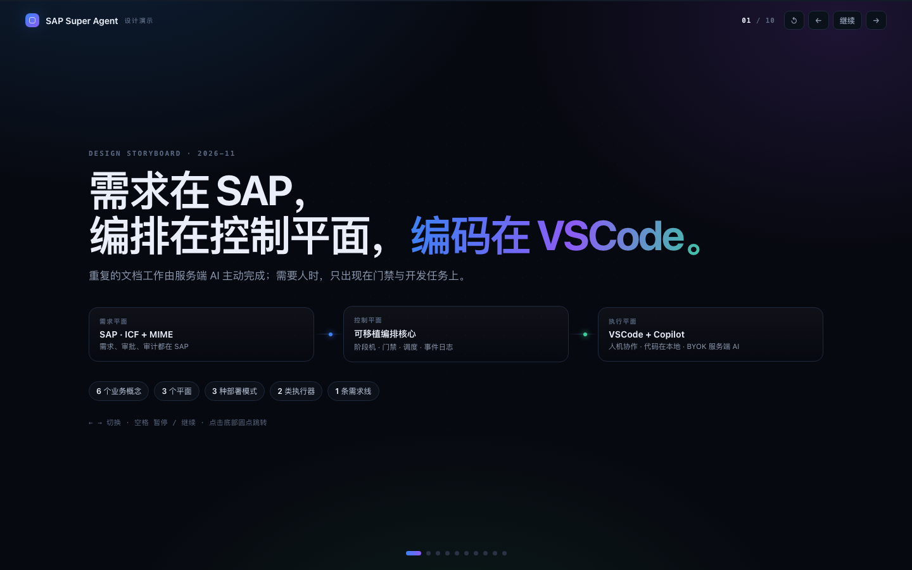

# SAP Super Agent · 设计演示



单文件 HTML 演示（无外部依赖），把 [docs/000–009](../docs/) 的设计整理成 10 幕动画：

| # | 幕 | 内容 |
| --- | --- | --- |
| 01 | 定位 | 三个平面与一句话定位 |
| 02 | 架构 | SAP / 控制平面 / 执行平面，三种真相 |
| 03 | 领域模型 | 6 个业务概念与状态机 |
| 04 | 部署模式 | M1 本地 / M2 独立服务 / M3 SAP 内批处理 |
| 05 | 主流程 | 六阶段、五门禁、执行器与工件 |
| 06 | 派单 | 在线/离线、租约、回池、server-ai 不看 presence |
| 07 | PDO 迁移 | 9 个动作 → 6 个阶段，Hook 留入口 |
| 08 | 客户端 | VSCode 扩展 + Copilot Chat + 上下文文件 |
| 09 | 安全 | 凭据可用不可见、BYOK、审计 |
| 10 | 交接 | H0 / H1 / H2 任务书与状态 |

## 打开

```sh
open index.html
```

- 自动演示；`←` `→` 切换，空格暂停/继续，`↺` 重播，底部圆点跳转。
- 设备/浏览器若开启“减少动态效果”，自动关闭动画并改为手动浏览。
- 截图或静态展示：在 URL 后加 `?static=1#s3`（第 3 幕），会禁用动画并跳到指定幕。
- 发布到 GitHub 后可直接在仓库里预览源码；动画页面需 clone 后用浏览器打开（或后续接 GitHub Pages）。

> 演示内容与文档冲突时以 [docs/](../docs/) 为准；本文件只是设计表达。
