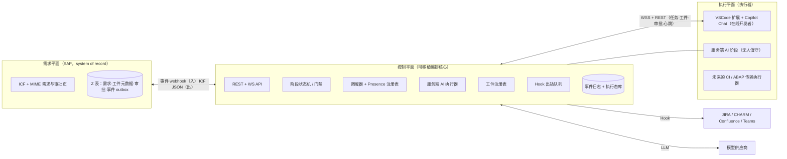
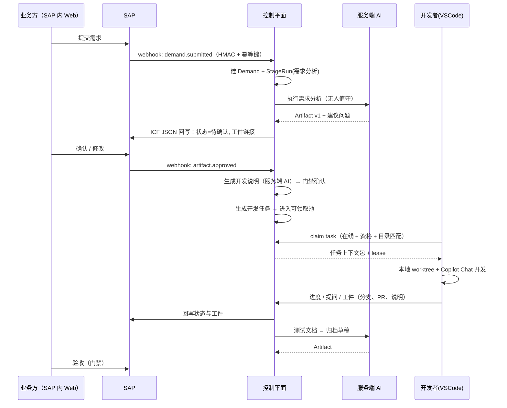
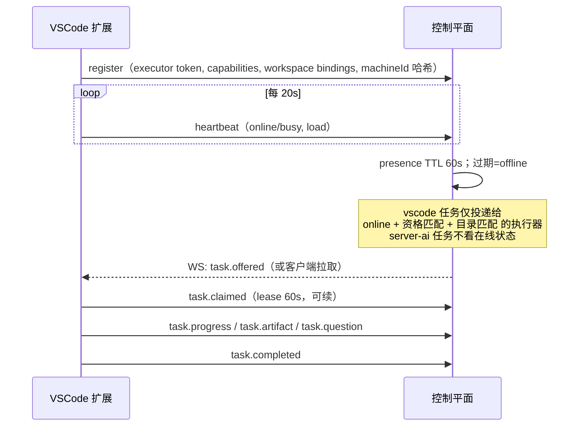

# 002 总体架构

本文给出目标系统的平面划分、部署模式与包边界。领域模型与协议细节见 [003-domain-and-protocol.md](003-domain-and-protocol.md)，SAP 侧见 [004-sap.md](004-sap.md)，客户端与 AI 见 [005-clients-and-ai.md](005-clients-and-ai.md)。

## 1. 三个平面

- **需求平面（SAP）**：需求、审批、业务数据的记录系统。只承载业务对象与其生命周期，不保存执行态。
- **控制平面**：唯一的执行态记录系统。负责把需求编排成阶段、生成或派发任务、记录工件与事件、执行门禁、对接外部系统。可移植：同一份领域核心可以跑在三种宿主里。
- **执行平面**：真正干活的地方。v1 有两种执行器：服务端 AI（结构化生成，离线可跑）与 VSCode 客户端（需要在线的人机协作开发）。M3（S5）把 `server-ai` 阶段改为由 SAP 侧批处理执行器执行（SAP 调企业 AI 网关，控制平面仍负责 prompt/校验/门禁），拓扑与部署见 [010-m3-deployment.md](010-m3-deployment.md)。

三者的边界用 ID 关联，不互相写真相：SAP 的 `DEMAND_ID` 是业务主键；控制平面的 `stageRun`/`task`/`assignment` 挂在它下面；VSCode 本地只认 `task` 与工作区绑定。

## 2. 三种部署模式

| 模式 | 组成 | 存储 | 适用 | 代价 / 限制 |
| --- | --- | --- | --- | --- |
| **M1 本地** | 单进程 CLI（`npx sap-superagent`），内嵌控制平面 + 服务端 AI 执行器；VSCode 扩展连本机 | SQLite + 本地文件 | 单人开发、演示、离线评估；"以某台电脑为主线" | 机器休眠/断网即停；不适合团队共享 |
| **M2 独立服务** | Docker Compose 或单二进制服务：API/WS、调度器、AI runner、Hook worker；可选 Web 运维页 | Postgres | 团队日常使用（推荐默认） | 需要一台常开机器/容器平台；多一套部署运维 |
| **M3 SAP 内批处理（不是主进程）** | SAP 承载需求系统、审批、审计与**批处理式**服务端 AI 阶段；交互编排仍由一个轻量服务运行（可与 SAP 同网段部署） | SAP 表 + 轻服务本地库 | 强监管/数据不出 SAP、已有 SAP 运维体系 | ABAP 不实现完整 agent 主循环；SAP 侧只做"记录 + 审批 + 批处理 AI" |

**建议**：默认 M2；M1 用于本地开发与演示；M3 定位为"SAP 内可控的批处理编排"，不要承诺"连交互式编码 agent 也跑在 ABAP 里"。M3 的判据与边界见 [004-sap.md](004-sap.md) 第 5 节；部署、网络、密钥与 runbook 见 [010-m3-deployment.md](010-m3-deployment.md)。

同一份 `@sap-superagent/core` 通过宿主适配器运行在 M1 本地进程或 M2 独立服务里；M3 的 ABAP 侧**不运行 core**，只通过 ICF JSON/HTTPS 与轻服务交互；批处理 AI 阶段默认由 SM36 周期 job 调度（bgRFC 为 Phase B 可选通道）。

## 3. 包与职责

| 包 | 职责 | 依赖 | 运行处 |
| --- | --- | --- | --- |
| `packages/protocol` | zod schema + 类型 + 事件 envelope；REST/WS 契约的唯一来源（生成 OpenAPI/JSON Schema） | 无 | 所有端 |
| `packages/core` | 领域模型、状态机、调度规则、门禁判定、纯函数；无 IO | protocol | 控制平面 |
| `packages/server` | 控制平面宿主：HTTP/WS、调度循环、presence、事件日志、SQLite/Postgres、Hook 出站 | core, protocol, ai, sap-adapter | M1/M2（M3 作为 SAP 旁路轻服务） |
| `packages/ai` | 服务端 AI 阶段：prompt 模板、结构化输出校验、BYOK 模型适配器（默认 OpenAI 兼容 / DeepSeek / Azure）、run ledger、成本限额 | protocol | server 内 |
| `packages/sap-adapter` | SAP ICF JSON 客户端、事件 webhook 网关、字段映射 | protocol | server 内 |
| `packages/clients/vscode` | VSCode 扩展：任务箱、Presence、工作区绑定、worktree、Copilot Chat 集成、工件回写 | protocol | 开发者机器 |
| `packages/clients/web` | 可选运维页（健康、队列、事件、开关）；不做业务主界面 | protocol | M2 |
| `packages/cli` | `init` / `dev` / `run` / `doctor` / `token`；M1 入口 | server | 本地 |
| `packages/mcp`（可选） | 把控制平面能力暴露为 MCP tools；v1.1 视需要实现 | protocol | 独立进程 |
| `sap/` | ABAP 侧 abapGit 仓库：DDIC、ICF handler、MIME Web、事件 outbox、bgRFC 批处理 job | — | SAP |
| `contracts/` | 由 protocol 生成的 OpenAPI、JSON Schema、示例 payload | protocol | 仓库 |

不引入 DSH 作为必需依赖。DSH / 其他 agent 运行时可以作为"服务端 AI 执行器"的一种实现（可选适配器），但不是本项目的骨架。

## 4. 三条核心数据流

### 4.1 一个需求的主干

### 4.2 在线 / 离线与派发

离线时：该执行器上未完成的 vscode 任务回到可领取池（保留已有工件与进度），最近持有者降权；服务端 AI 阶段照常推进。

### 4.3 门禁与主动推进

Gate 是模板里的规则（无状态）；Approval 是门禁实例（`pending → approved | rejected | withdrawn | expired`）；StageRun 到达门禁时进入 `waiting_human`。阻塞在门禁上的阶段不占用调度资源；其余阶段只要依赖工件就绪就立即执行。因此"主动处理"不是让 agent 自己找活，而是**流水线在无人时继续走无人步骤**。

## 5. 关键设计决策

| 决策 | 选择 | 理由 | 代价 |
| --- | --- | --- | --- |
| 真相归属 | SAP 业务对象 / 控制平面执行态 / 客户端工作区，三分 | 避免双写与状态漂移；各自可独立演进 | 需要明确 ID 映射与对账 job |
| 派发模型 | 池 + 资格匹配 + 客户端 claim + lease | 离线/休假/离职不影响流程；避免 push 到不可用的人 | 需要 presence 与超时回收 |
| 客户端执行 | 默认在开发者已打开的工作区进行；worktree 可选 | 少一步操作，符合"简洁"；隔离需求用命令一键创建 | 工作区污染风险由扩展提示与命令兜底 |
| 双 AI 通道 | 服务端 AI 做结构化生成；客户端 Copilot 做实现 | 可审计、批量、离线 vs 上下文完整、人机同屏 | 两种成本与权限模型 |
| 需求系统位置 | SAP 记录业务对象；不做聊天流 | SAP 已有权限/审计/审批体系；聊天流不适合长周期流程 | SAP 侧需要开发少量对象 |
| 存储 | M1 用 SQLite；M2 默认 Postgres（SQLite 仅本地） | M1 零依赖；M2 可扩展 | 两套迁移脚本需同源 |
| 服务端模型接入 | BYOK：企业自有 Key（OpenAI 兼容 / DeepSeek / Azure / 企业网关），适配器可替换 | 成本与合规可控，不绑定 Copilot 订阅；PDO 旧链路可平滑迁移 | 需要 Key 管理与按模型评测 |
| SAP 对接 | ICF 节点 + JSON API + MIME 静态页（不用 RAP/OData） | 与 abap-cli 能力完全匹配、无 RAP 版本门槛、单 handler 可控 | 需自写 JSON 序列化、路由与前端资源管理 |
| MCP | 可选工具层（`packages/mcp`），v1.1 视需要实现 | 跨客户端复用（Copilot/Claude/其他 IDE） | 多一层协议与鉴权 |
| 认证 | M1 用 CLI 签发的静态 token；M2/M3 用 OAuth Device Grant + 短期 JWT + refresh + webhook HMAC；SSO 后置 | 先跑通；企业 SSO 作为 M2/M3 增强 | M2/M3 需要 device flow 与 token 轮换实现 |
| Copilot 集成 | extension tools + 上下文文件 + custom agent/skill；**不用 Chat Participant** | 官方已将其标记为 deprecated，且扩展无法读取/驱动 Copilot 会话 | 需要把任务操作做成 LM Tool，而非"接管聊天" |
| 仓库形态 | monorepo（pnpm workspaces） | 协议/核心/端一致演进；AI agent 易导航 | CI 需要按包过滤 |

## 6. MVP 切片（walking skeleton）

| 切片 | 内容 | 验收 |
| --- | --- | --- |
| S0 骨架 | protocol + core 状态机 + server 最小 API + VSCode 任务箱 | 本地建需求→AI 生成分析→客户端领取→回写工件，全链路可跑 |
| S1 门禁 | 审批、工件版本、阶段模板（默认 3 阶段 / PDO 6 阶段预设） | 审批前后状态与审计正确；模板可切换 |
| S2 SAP | DDIC + ICF JSON + MIME Web + 事件 webhook + 回写 | SAP 里提交需求 5 分钟内出现在控制平面 |
| S3 多人在线 | presence、lease 回收、资格匹配、转交 | 断网/关机后任务自动回池；他人可接手 |
| S4 Hook | JIRA / CHARM / Confluence / Teams 契约 + 一个示例适配器 | 出站事件可重放、幂等 |
| S5 SAP 宿主 | SAP 批处理 AI 阶段（SM36 周期 job 默认、bgRFC Phase B 可选）+ SAP 内审批 | 无开发者在线时，需求分析/测试文档仍能生成；M3 部署见 [010](010-m3-deployment.md) |

## 7. 非功能基线

- **安全**：客户端只持有自己的 executor token；服务端 AI 密钥不出服务端；SAP webhook 用 HMAC + 时间戳；所有跨端调用 TLS。M3 下企业 AI 网关 key 只在 SAP 安全存储（`ZSA_CFG.AI_KEY_REF` 只存引用名），控制平面不持有；prompt/输出只在"控制平面 → SAP → 内网网关"路径传输，SAP 与控制平面日志不落正文。
- **凭据可用不可见**：控制平面不持有开发者的 SAP/SSO 凭据，模型上下文不含凭据；扩展在本地作用域调用 `abap-cli`、git 等有权动作，只回传结果摘要。控制平面被攻破或提示注入不能直接接管开发者机器。
- **能力降级**：Copilot 是否可用、extension tools 是否被企业策略禁用，启动时探测；不可用时扩展退化为"任务客户端 + 本地 abap-cli"，主流程不断。
- **可观测**：每个状态变化写不可变事件；`/healthz`、队列深度、租约回收数、AI 成本按天统计。M3 的 job 队列计数、`lastError` 与 `stage.ai_job.*` 事件见 [010 §8](010-m3-deployment.md#8-运行手册runbook)。
- **性能目标**：派发延迟 ≤2s（在线客户端）；presence 过期 60s；单控制平面 100 并发任务、10k 事件/天起步。M3 的控制平面是单节点轻服务（SQLite + 本地工件目录），不做水平扩展；批处理 job 的领取延迟由 SM36 周期决定（建议 1 分钟）。
- **可恢复**：M2 重启后任务/租约/工件不丢；WS 断线重连后按游标补齐事件。
- **可测试**：core 为纯函数 + 内存仓库单测；协议有 schema 快照；端到端用本地模式跑；失败场景矩阵见 [009-testing.md](009-testing.md)。
