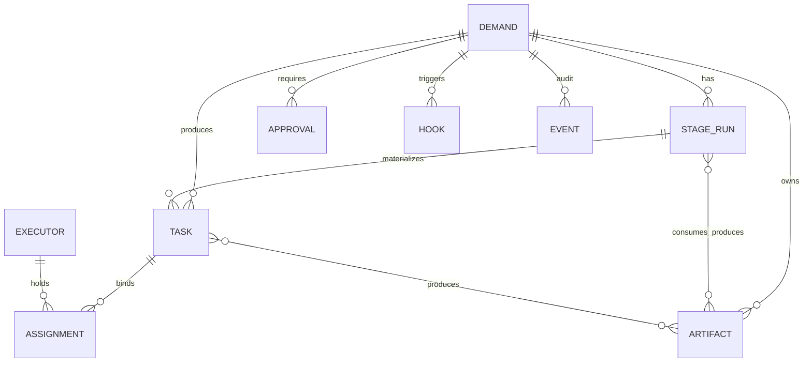
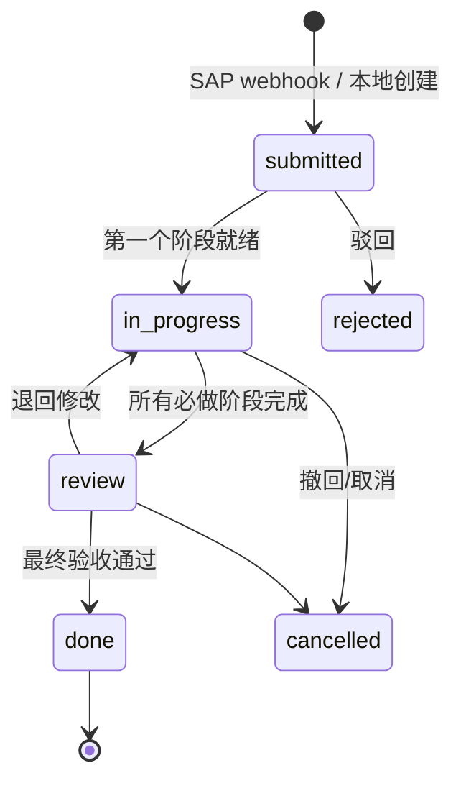
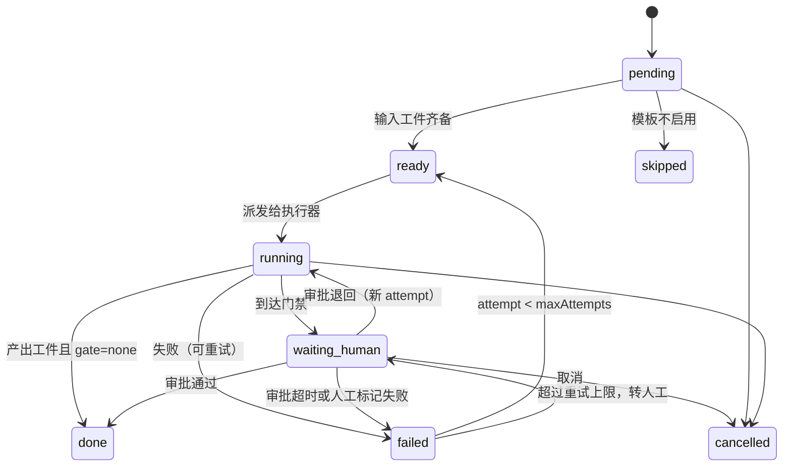

# 003 领域模型与协议

本文定义六个业务概念（需求、阶段、任务、指派、工件、门禁）和三个支撑对象（执行器、Hook、事件），以及控制平面对外契约。实现以本文为准；`packages/protocol` 是机器可读版本。

## 1. 实体关系



## 2. 状态机

### 2.1 需求 Demand



- `done`、`rejected`、`cancelled` 为终态；退回修改在**同一 StageRun** 上开新 attempt，不新建 StageRun，历史 attempt 与工件版本保留。
- 需求本身不保存执行进度，进度由 StageRun 计算得出（单一事实来源）。

### 2.2 阶段运行 StageRun



规则：

- 一个 Demand 的一个 Stage 只有一个 StageRun；重试/退回都在同一 StageRun 上增加 `attempt`，旧 attempt 的事件与工件保留。
- 阶段完成必须产出声明的输出工件，且通过 **schema 校验 + 模板 checklist**（引用完整性、必填项覆盖、上游版本一致）；只过 schema 不算完成。
- 每次 `server-ai` 执行都记一条 run ledger（模型、prompt 版本、输入工件版本、token、成本、耗时、失败原因），落在 `stage_attempts`，供成本统计与复现（实现补充）。
- 上游工件产生新版本时，下游已生成工件标记 `stale` 并阻断继续推进，直到重新生成或人工确认。
- 门禁由模板声明（`gate: none | human-approve`）。没有门禁的阶段全自动。

### 2.3 任务 Task 与指派 Assignment

Task 字段：

| 字段 | 说明 |
| --- | --- |
| `id` | ULID（控制平面生成） |
| `demandId` | 需求 ID；SAP 来源时为 UUID C32，控制平面不二次生成 |
| `stageRunId` | 产生该任务的阶段运行 |
| `title` | 一句话任务名 |
| `executorKind` | `vscode`（人机）或 `server-ai`（批处理） |
| `requiredRoles` | 角色列表（空表示不限） |
| `workspaceBinding` | 可空：`{repo, projectKey, baseBranch}`；有值时按工作区派发，为空时进入通用任务箱（按角色/团队）。**不含本地路径** |
| `priority` | `high / normal / low` |
| `dueAt` | 期望完成时间（可空） |
| `state` | 见下方状态机 |
| `lastHolderUserIds` | 最近释放/过期该任务的用户（最多 3 个），用于回池降权 |
| `createdAt` / `updatedAt` | UTC 时间 |

Task 状态：`pending → claimed → in_progress → completed | failed | cancelled`；`released/expired` 退回 `pending`。`offered` 只是 WS 提示（不持久化），任务本身仍为 `pending`。

Assignment 状态：`active → completed | released | expired`。

- 任务不预绑定到人。`claim` 原子成功后才产生 Assignment 与租约。
- 租约：默认 60s，客户端每 20s 续约；过期自动 `expired`，任务回 `pending`，已提交工件保留。
- `complete`/`fail` 必须携带当前租约；租约失效后的写入被拒绝，防止两个客户端同时写。
- 任务并发：每执行器 `maxConcurrent`（默认 2），每用户同一需求最多 1 个活跃人工任务（避免自己挤自己）。
- 回池不重复派给刚释放的人：按 `lastHolderUserIds` 对最近 3 位降权（排序加权重），不硬排除。

### 2.4 工件 Artifact

状态：`draft → generated → in_review → approved | rejected`；新版本使旧版本 `superseded`。

- 工件不可变：任何修改产生新 `version`，`artifactId` 不变，`contentRef` 指向存储对象。
- 工件必须声明 `kind`（`requirement_analysis`、`dev_spec`、`code_change`、`test_doc`、`knowledge_entry`、`free_note`）、`contentType`、`checksum`。
- 工件来源：`ai`（服务端生成）、`human`（SAP 或 Web 编辑）、`agent`（客户端回写）、`import`（外部系统）。

### 2.5 门禁 Approval

状态：`pending → approved | rejected`；`pending → withdrawn`（发起人撤回）；`pending → expired`（`timeoutDays` 到期）。
`approved` 后阶段进入下一阶段；`rejected` 后阶段回 `running`（新 attempt）或按模板 `cancelled`。

- 门禁绑定 `(demandId, stageRunId, gateKey)`；同一门禁重复审批幂等，终态后拒绝再次决策。
- 审批人由模板声明的角色决定；角色枚举：`requester`（业务方）、`consultant`（需求顾问/PDO）、`developer`、`ops`。控制平面只做规则校验，身份来自 SAP 或控制平面账号。

### 2.6 执行器 Executor

| 字段 | 说明 |
| --- | --- |
| `kind` | `vscode`（人机客户端）、`server-ai`（服务端批处理）、未来 `ci` / `abap-transport` |
| `user` | 所属用户（vscode）/ 系统账号（server-ai） |
| `capabilities` | `coding`、`doc-review`、`test-run` 等；与任务要求匹配 |
| `roles` | 允许领取的角色（后端、ABAP、测试……） |
| `workspaces` | `{workspaceKey, repo, projectKey, baseBranch, localPathHint?}` 列表；`workspaceKey = sha256(规范化后的工作区 URI)`，只属于执行器（当前打开的目录），任务侧只带 repo/projectKey |
| `activeWorkspaceKey` | 当前**打开**的工作区 key（必须属于 `workspaces`）；由心跳更新；为 `null` 或不属于列表即视为不可派单。实现补充：该字段原在 §3 规则中出现但 §2.6 未定义 |
| `machineIdHash` | `sha256(vscode.env.machineId)`；只存哈希，用于"同目录重复打开"与审计 |
| `presence` | `online / busy / away / offline`，由 WS 连接、心跳与显式状态计算 |
| `accepting` | 布尔；`false` 表示用户暂停接单（仍在线）。`server-ai` 恒为 online 且 accepting=true（全局 paused 除外） |

### 2.7 阶段模板 StageTemplate

| 字段 | 说明 |
| --- | --- |
| `templateId` | 模板 ID，如 `default`、`pdo` |
| `version` | 整数；Demand 创建时固定 `templateVersion`，之后模板变更只影响新 Demand |
| `stages` | 有序阶段：`{key, name, executorKind, inputArtifactKinds[], outputArtifactKind, gate, maxAttempts, checklist[]}` |
| `gates` | `{gateKey, role, timeoutDays}` |

- `executorKind ∈ {vscode, server-ai}`；`gate ∈ {none} | {gateKey, role}`，`none` 表示全自动。
- `checklist` 是可判定的验收断言（如"每条验收标准可追到需求原文锚点""模板必填项齐全"），阶段完成条件 = schema + checklist。
- 模板文件放仓库根 `templates/<templateId>.yaml`，schema 在 `packages/protocol`，启动时校验；`templateVersion` 写入 Demand。
- 内置两个模板：`default`（3 阶段：需求分析 / 开发实现 / 验收归档，门禁 G1/G3/G4）与 `pdo`（6 阶段，见 [005 §4](005-clients-and-ai.md)）。

## 3. 调度规则（确定性）

任务进入可领取池后，按以下规则判定资格；全部满足才可 `claim`：

1. `task.state == pending` 且未被租约占用。
2. `task.executorKind` 与 `executor.kind` 相符：`vscode` 任务只给 vscode 执行器；`server-ai` 任务只给服务端执行器。
3. 角色匹配：`task.requiredRoles ⊆ executor.roles`（空表示不限）。
4. 工作区匹配：`task.workspaceBinding` 为空表示通用任务（按角色/团队即可领取）；非空时要求 `repo/projectKey` 与执行器声明有交集，且 `activeWorkspaceKey` 属于其声明的 workspaces（即**当前打开目录**；目录一换即视为离线）。绑定可由需求顾问在受理时补充，或由用户账号维护的工作区列表决定。
5. 在线约束：vscode 任务要求 presence ∈ {online, busy} 且 `accepting=true`、`load < maxConcurrent`；server-ai 任务不看 presence。
6. 用户并发：同一用户未超过 `maxConcurrentPerUser`。

**离线判定**（任一条件成立即视为不可派单）：WS 断开且心跳超过 TTL；`activeWorkspaceKey` 不属于声明的 workspaces；`accepting=false`；服务端全局 `paused`。客户端不依赖操作系统的"网络在线"事件，也不用本地时钟判断租约过期（以 `serverTime` 为准）。

排序：priority 降序 → dueAt 升序 → createdAt 升序。客户端主动拉取（pull）+ 服务端 WS 提示，倾向"谁先到谁领"。

派发事件：

- 执行器上线 / 工作区绑定变化 → 服务端重算可领取列表并推送 `task.offered`。
- 任务新增 → 推送给所有满足 1–5 的在线执行器（只含摘要，不含工件内容）。
- 租约过期 → 写 `assignment.expired` 事件，任务回池并推送给其他候选。

## 4. 控制平面协议

### 4.1 通用约定

- Base：`/api/v1`；所有响应 JSON。时间一律 ISO-8601 UTC。控制平面生成的实体（stageRun/task/assignment/approval/event）用 ULID；来自外部系统的实体沿用外部主键并用 `externalId` 标注：`demandId` 用 SAP UUID C32，控制平面不再二次生成。
- 认证：`Authorization: Bearer <token>`。token 类型：`user`（审批/查看）、`executor`（任务操作）、`admin`（运维）。M1 本地模式用 CLI 签发的静态 token；M2/M3 首次登录用 OAuth 2.0 Device Authorization Grant（RFC 8628）换取短期 JWT + refresh token；客户端把 refresh token 存 VSCode `SecretStorage`，不落工作区文件。SAP 入站用 `X-SA-Signature: hmac-sha256(body, secret)` + `X-SA-Timestamp`（±5 分钟）+ `X-SA-Delivery`（幂等键）。
- 写操作支持 `Idempotency-Key`，服务端保留 24h 结果。
- 乐观并发：任务/工件更新可带 `If-Match: <version>`；不一致返回 `409 conflict`。
- 错误体：`{"error":{"code":"lease_expired","message":"...","retryable":true,"details":{}}}`；`429` 带 `Retry-After`。
- 版本化：`/api/v1` 只做加法；破坏性变更升 `v2`。执行器注册时上报 `protocolVersion`，服务端可拒绝过旧版本。

### 4.2 执行器接口

| 方法 | 路径 | 说明 |
| --- | --- | --- |
| POST | `/executors/register` | 注册并换取 executor token；声明 kind/user/machineIdHash/capabilities/roles/workspaces/protocolVersion/cliVersion |
| POST | `/executors/{id}/heartbeat` | 每 20s：`{status, load, workspaces?, activeWorkspaceKey?}` → `{serverTime, leaseTtlMs, renewIntervalMs, offers}`；服务端 TTL 60s |
| DELETE | `/executors/{id}` | 优雅下线；立即回收其活跃任务 |
| GET | `/tasks` | 查询可领取任务（已按资格过滤）；`?state=pending&limit=20` |
| GET | `/tasks/{id}` | 任务详情 + 门禁/工件摘要 |
| GET | `/tasks/{id}/context` | 返回 Markdown 上下文包 + JSON（需求摘要、上游工件、验收标准、工作区绑定、禁止项） |
| POST | `/tasks/{id}/claim` | 原子领取（`Idempotency-Key` + `If-Match`）；返回 task + lease + context 摘要；冲突 409 + 当前持有者摘要 |
| POST | `/tasks/{id}/lease/renew` | 续约；返回新过期时间；404/409 时客户端必须停止执行并重新拉状态 |
| POST | `/tasks/{id}/progress` | `{percent?, message, summary?}`；写事件，不阻塞 |
| POST | `/tasks/{id}/artifacts` | 提交工件 `{kind, contentType, contentUrl|contentBase64, checksum, summary}` |
| POST | `/tasks/{id}/question` | 提问 → 生成 `waiting_human` 通知；任务可继续或挂起（模板决定） |
| POST | `/tasks/{id}/complete` | 完成：`{summary, artifactIds, links, openQuestions?}` |
| POST | `/tasks/{id}/fail` | 失败：`{reason, retryable}` |
| POST | `/tasks/{id}/release` | 主动放弃租约，任务回池并通知派发人 |
| GET | `/events/stream?after=<seq>` | SSE 只读降级通道（WS 不可用时）；`Last-Event-ID` 语义同 `after` |

### 4.3 用户与需求接口

| 方法 | 路径 | 说明 |
| --- | --- | --- |
| POST | `/demands` | 本地模式创建需求；SAP 模式由 webhook 创建 |
| GET | `/demands/{id}` | 需求、阶段、工件、门禁、事件时间线 |
| GET | `/demands?status=&assignee=&q=` | 列表与搜索 |
| POST | `/demands/{id}/cancel` | 撤回 |
| GET | `/approvals?assignee=me` | 我的待审批 |
| POST | `/approvals/{id}/decisions` | `{decision: "approve"|"reject", comment}` |
| GET | `/events?after=<seq>&limit=200` | 增量事件（WS 断线补拉） |
| GET | `/healthz` `/metrics` | 运维 |

### 4.4 WebSocket 事件流

连接：`wss://<host>/api/v1/events?after=<lastSeq>`，token 同 REST。断线重连携带 `lastSeq` 补齐；事件日志保留 ≥7 天（M1 可配 24h），游标超出保留窗口时 REST 返回 `resync_required`，WS 收到控制帧 `{"type":"resync_required","lastSeq","earliestSeq"}`，客户端全量拉取。WS 不可用时降级到 `GET /events/stream`（SSE，只读）。

统一 envelope：

```json
{ "seq": 12043, "id": "01J...", "type": "task.offered", "at": "2026-11-04T12:00:00Z",
  "subject": { "type": "task", "id": "01J..." }, "data": { } }
```

| 方向 | type | 触发 |
| --- | --- | --- |
| 服务端→客户端 | `task.offered` / `task.updated` / `task.cancelled` | 新可领取任务、租约状态变化、任务取消 |
| 服务端→客户端 | `approval.requested` / `demand.updated` | 审批与需求状态变化 |
| 服务端→客户端 | `server.ping` | 保活与时钟校准 |
| 客户端→服务端 | `client.pong` / `client.ack {seq}` | 保活与游标确认 |

只推送**摘要**；工件内容与上下文包走 REST 按需拉取，避免大消息与重复传输。

### 4.5 SAP 入站 webhook

`POST /hooks/sap`（HMAC + 幂等键），`data.type`：

| type | 何时 | 控制平面动作 |
| --- | --- | --- |
| `demand.submitted` | 需求提交 | 建 Demand + 启动模板第一阶段 |
| `demand.updated` | 需求字段变化 | 更新快照；必要时重开阶段 |
| `artifact.approved` / `artifact.rejected` | 门禁结果 | 解决对应 Approval，推进/退回阶段 |
| `demand.cancelled` | 取消 | 取消需求与所有任务 |
| `hook.receipt` | 外部系统完成（JIRA/CHARM 回执） | 记录 Hook 回执，推进阶段 |

### 4.6 示例：一次领取与提交

```json
// POST /tasks/01J8.../claim  →
{ "task": { "id": "01J8...", "demandId": "4a3f9c2e7b1d48f0a6c5e2d9b8f7a1c3", "title": "实现需求 R-2041 的取数逻辑",
    "requiredRoles": ["abap"], "workspaceBinding": { "repo": "z-sales", "baseBranch": "main" } },
  "lease": { "expiresAt": "2026-11-04T12:01:00Z", "renewIntervalMs": 20000 },
  "contextUrl": "/api/v1/tasks/01J8.../context" }

// POST /tasks/01J8.../artifacts →
{ "artifact": { "id": "01J9...", "kind": "code_change", "version": 1,
    "contentRef": "artifact://01J9.../v1", "checksum": "sha256:..." }, "taskState": "in_progress" }
```

## 5. 工件与上下文

- **存储可插拔**：本地文件（M1）、S3/对象存储（M2）、SAP 附件/内容仓库（M3）。控制平面只存元数据、checksum 与引用。M1 实现补充：本地模式把内容写到 `SA_STATE_DIR/artifacts/<artifactId>/v<n>.bin`，接口只接受 `contentBase64`（`contentUrl` 预留给 M2 对象存储）；checksum 必须等于解码后字节的 sha256。
- **上下文包**是工件的只读快照，不是新概念：由需求摘要、输入工件、验收标准、工作区绑定和禁止项组成，扩展负责写入 `.sap-superagent/context/<taskId>.md`，供 Copilot Chat 引用。
- **审计**：工件每次创建/审批写事件；事件只追加，不更新。

## 6. 扩展点

| 扩展点 | 接口 | v1 实现 | 未来 |
| --- | --- | --- | --- |
| 需求来源 | `SourceAdapter`：`ingest(event)` / `writeBack(demand)` / `reconcile()` | 本地 REST、SAP ICF JSON + webhook | JIRA、ServiceNow |
| 执行器 | 4.2 协议 | `vscode`、`server-ai` | CI、ABAP 传输、DSH session |
| AI 阶段 | `AiStage`：`buildPrompt(ctx)` / `outputSchema` / `model` / `maxCostUsd` | 需求分析、开发说明、测试文档、归档摘要 | 更多模板 |
| Hook 目标 | `HookTarget`：`event` / `payload(demand, artifact)` / `send()` / `idempotencyKey` | 契约见 [008-hooks.md](008-hooks.md)，v1 提供 `http` 示例 | JIRA、CHARM、Confluence、Teams |
| 存储 | `Repository` / `ArtifactStore` / `EventStore` | SQLite + FS；Postgres 可选 | SAP HANA |
| 身份 | `TokenValidator` | 本地签发 token | OIDC / SAP SSO |
