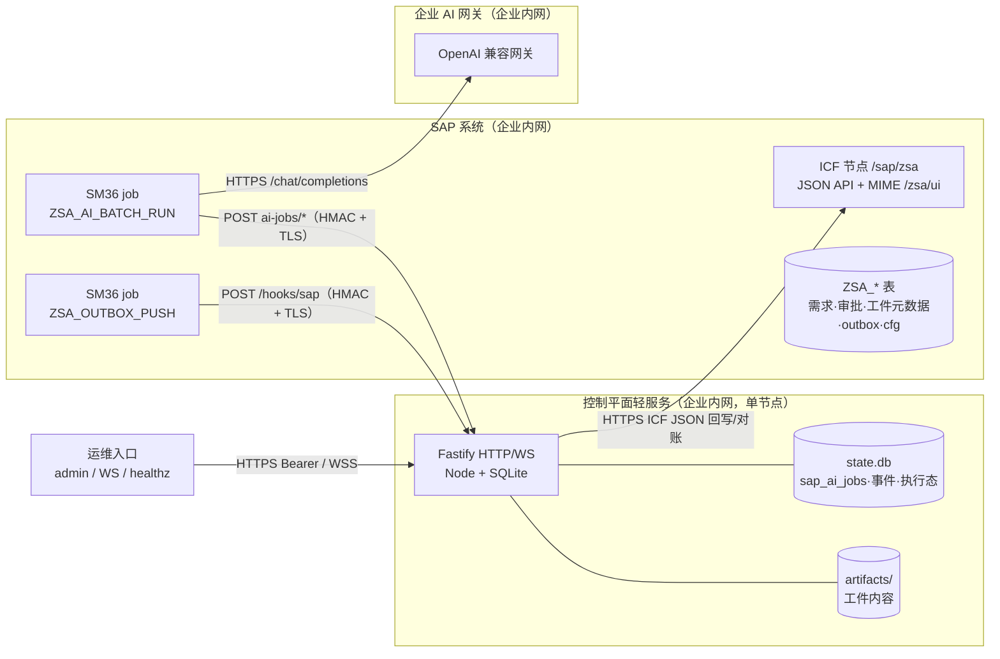

# 010 M3 部署与运维（SAP 宿主受限模式）

本文是 S5/M3 的部署与运维口径：把控制平面的 `server-ai` 阶段委派给 **SAP 内批处理执行器**（`ZCL_ZSA_AI_BATCH`）时，控制平面、SAP、企业 AI 网关三者的**拓扑、网络、配置、部署、数据边界、故障处置与验收**。

- 协议权威定义：[003 §4.8](003-domain-and-protocol.md#48-sap-批处理-ai-执行器m3s5)（冻结契约，本文不复制语义细节）；事件与端点也以 003 为准。
- 任务书与验收标准：[handoffs/S5-sap-hosted-mode.md](../handoffs/S5-sap-hosted-mode.md)；执行交底：[handoffs/S5-execution-handoff.md](../handoffs/S5-execution-handoff.md)。
- SAP 对象创建/推送/激活与 `$ZSA` 的实测细节：[sap/README.md](../sap/README.md)。
- M3 的系统定位与边界：[004 §7.1](004-sap.md#71-m3-落地边界s5-实现口径)；网关路径：[005 §3.3](005-clients-and-ai.md#33-模型接入可替换)。

> 交付状态：**Phase A（离线）已交付**，M3 的控制平面/ABAP/假件均可离线验证；**Phase B（真机）blocked**，所需人工输入见 [§9.3](#93-phase-b-人工输入清单blocked-判据)。本文不包含任何真实地址、密钥或传输请求号；所有 `<...>` 均为现场替换的占位符。

## 1. M3 是什么、不是什么

M3 是"**SAP 记录业务事实 + 轻量控制平面记录执行事实 + SAP 批处理 AI**"的部署形态，由三块组成：

| 组件 | 承载 | 职责 |
| --- | --- | --- |
| SAP 系统（`$ZSA` 本地包） | ICF `/sap/zsa`、MIME `/zsa/ui`、`ZSA_*` 表、SM36 后台 job | 需求/审批/审计的记录系统；拉取 AI job、调用企业 AI 网关、回传模型**原始输出**；事件 outbox 推送 |
| 控制平面（Node + SQLite，单节点） | HTTP/WS、stage-runner、job 队列 `sap_ai_jobs`、工件与事件 | 唯一的执行态记录系统：prompt 渲染、job 队列/租约/幂等、输出校验、checklist、ledger、工件、门禁与审批推进 |
| 企业 AI 网关（内网） | OpenAI 兼容 `POST <AI_GATEWAY_URL>/chat/completions` | 模型调用与计费；SAP 用安全存储里的 key 引用访问 |

边界（与 [004 §7.1](004-sap.md#71-m3-落地边界s5-实现口径) 一致）：

- **SAP 只做批处理执行器 + 网关调用**：不拼 prompt、不做 JSON 提取/schema/checklist/业务重试决策；不实现交互式 agent、流式输出、ABAP 全量控制平面。
- **控制平面仍独占状态机**：job 生命周期、租约、结果幂等、工件版本、门禁/审批推进、审计事件。
- **默认关闭**：不设 `SA_SAP_AI_BATCH`（或 `0`）时行为与 H0–S4 完全一致，本地 `ctx.aiProvider` 执行，SAP job API 不注册。
- **无外网依赖**：三块都在企业内网；控制平面不访问公网、不访问 AI 网关；模型流量只走 SAP → 内网网关。

## 2. 拓扑



一次 AI 阶段的数据流（编号对应 [003 §4.8](003-domain-and-protocol.md#48-sap-批处理-ai-执行器m3s5)）：

1. 阶段 `ready` 且命中委派 → 控制平面照常 claim（`running` + `stage.started`），**不调用本地 provider**；`renderAiStageMessages` 渲染 prompt，写 `sap_ai_jobs` 行（`queued`）+ 持久事件 `stage.ai_job.queued`。
2. SAP 的 `ZSA_AI_BATCH_RUN` 周期 job（默认 1 分钟）调 `POST /api/v1/sap/ai-jobs/next` 取可领取 job（只读）。
3. `POST /api/v1/sap/ai-jobs/{id}/claim` 取 `claimId` + 租约（写 `stage.ai_job.claimed`）；长任务用 `POST /api/v1/sap/ai-jobs/{id}/heartbeat` 续租。
4. SAP 用 `ZSA_CFG` 的网关配置调企业 AI 网关（`AI_KEY_REF` 指向安全存储，不落明文）。
5. `POST /api/v1/sap/ai-jobs/{id}/result` 回传模型**原始输出文本**（或 `failed` + 错误）。
6. 控制平面做 JSON 提取 → 输出 schema → checklist → attempt ledger → 工件 + 门禁/推进（与本地 AI 阶段同一份完成语义），写 `stage.ai_job.completed` / `failed`。
7. SAP 内审批仍走既有审批联邦：SAP Web → `ZSA_EVENT_OUT` → `ZSA_OUTBOX_PUSH` → `POST /hooks/sap`（HMAC）→ 控制平面推进阶段；控制平面通过 ICF JSON 回写状态投影（服务账号）。
8. 全程**无开发者上线**也能推进到需求完成（Phase A 用 `FakeSapAiBatch` + `FakeAiGateway` 在 e2e 中证明）。

## 3. 网络矩阵

### 3.1 连接矩阵

| # | 源 → 目标 | 端口/协议 | 用途 | 认证 | TLS | 防火墙 |
| --- | --- | --- | --- | --- | --- | --- |
| N1 | SAP 应用服务器 → 控制平面（反向代理） | 443/TCP HTTPS | `POST /api/v1/sap/ai-jobs/{next,{id}/claim,{id}/heartbeat,{id}/result}`；回传结果与心跳 | `X-SA-Signature/Timestamp/Delivery` HMAC（secret = `SA_SAP_HOOK_SECRET`） | 必须 | 仅放行 SAP 应用服务器网段 → CP 443 |
| N2 | SAP 应用服务器 → 控制平面（反向代理） | 443/TCP HTTPS | `POST /hooks/sap`（S2 既有：需求提交/审批/取消事件 outbox 推送） | 同上 HMAC | 必须 | 同上 |
| N3 | 控制平面 → SAP 应用服务器 | 443/TCP HTTPS（ICF） | `GET/PATCH /sap/zsa/api/demands*` 回写与对账（S2 既有） | 服务账号（IdP OAuth2 client credentials 或 basic over TLS，`SA_SAP_SERVICE_*`） | 必须 | 仅放行 CP → SAP ICF 端口 |
| N4 | SAP 应用服务器 → 企业 AI 网关 | 443/TCP HTTPS | `POST <AI_GATEWAY_URL>/chat/completions` | 网关 key（SAP 安全存储，`AI_KEY_REF`） | 必须 | 仅放行 SAP → 网关 443；**不**放行控制平面到网关 |
| N5 | 运维终端 → 控制平面（反向代理） | 443/TCP HTTPS + WSS | admin 运维 API、`/hooks/sap/status`、WS `wss://<cp-host>/api/v1/events`、`/api/v1/healthz` | Bearer admin/user token | 必须 | 仅运维网段；不暴露公网 |
| N6 | 监控/运维 → 控制平面 | 443/TCP HTTPS | `GET /api/v1/healthz`、`GET /hooks/sap/status` 轮询 | healthz 无鉴权；status 需 admin Bearer | 必须 | 同上 |
| N7 | SAP 应用服务器 / 控制平面 → 内网 NTP | 123/UDP（或现场既有对时） | 时钟同步（HMAC 时间窗 ±5 分钟） | — | — | 按企业基线 |

补充约束：

- **控制平面自身监听不是 TLS 终点**：它只提供 HTTP（`SA_HTTP_PORT`，默认 `3080`）。对外必须经反向代理终止 TLS；代理到控制平面建议只走 `127.0.0.1`，不要跨网段暴露 `3080`。
- **不做双向 mTLS**：SAP ↔ 控制平面用应用层 HMAC 鉴权 + 服务端 TLS 证书校验即可；如企业要求 mTLS，可在反向代理层加，S5 契约不依赖它。
- **控制平面不访问公网**：不需要出站 80/443 到互联网；所有回调都是 SAP 主动连控制平面。
- **SAP 只访问控制平面与 AI 网关**：不要求 SAP 直连控制平面的数据库/文件系统；反之控制平面不读 SAP 表，只走 ICF JSON。

### 3.2 TLS 与证书

| 链路 | 服务端证书 | 信任方配置 |
| --- | --- | --- |
| SAP → 控制平面（N1/N2） | 反向代理证书（CN/SAN = `<cp-host>`，企业内 CA 签发） | SAP 侧在 `STRUST` 的 **SSL client PSE** 导入 CP 证书链/企业根 CA；否则 `cl_http_client` 出站握手失败 |
| 控制平面 → SAP（N3） | SAP ICF 服务器证书（SAP 标准/企业 CA） | 控制平面 Node 进程信任企业 CA：把根证书 PEM 放 `/etc/sap-superagent/ca.pem` 并设 `NODE_EXTRA_CA_CERTS=/etc/sap-superagent/ca.pem`，或导入主机信任库 |
| SAP → AI 网关（N4） | 网关证书（企业 CA） | SAP 侧 SSL client PSE 导入网关证书链 |

要求：

- 证书 **用主机名（DNS）访问**，不要用 IP 直连，避免 SAN 不匹配；`CONTROL_PLANE_URL`、`AI_GATEWAY_URL` 与证书 SAN 保持一致。
- 不得关闭证书校验（不要 `insecure`、不要跳过 verify）；内网自签场景必须把企业 CA 装进对应信任库。
- 证书到期前轮换；轮换 CP 证书时同步更新 SAP 的 SSL client PSE（否则 job 调用 401 之前先 SSL 失败）。

### 3.3 端口清单

| 进程/系统 | 端口 | 监听建议 |
| --- | --- | --- |
| 控制平面（Node） | `SA_HTTP_PORT`，默认 `3080/TCP` | 只监听 `127.0.0.1`（后面放反向代理）；同机部署代理最省事 |
| 反向代理（Caddy/Nginx） | `443/TCP`（可加 `80` 仅做跳转/ACME 内网 CA） | 监听内网网卡；对 SAP/运维网段放行 |
| SAP ICF | 由 Basis 决定的 HTTPS 端口（常见 `44300` 等） | CP → SAP 放行 |
| AI 网关 | `443/TCP` | SAP → 网关放行 |
| SQLite / 工件 | 无网络端口 | 本地磁盘，不共享 |

### 3.4 时钟

- SAP 与控制平面都要对时：HMAC 时间窗为 **±5 分钟**（`SA_SAP_HOOK_TOLERANCE_MS` 可调，但不建议放大）。
- 时间漂移的典型症状：SAP job 调用 job API / `/hooks/sap` 返回 `401`，错误信息提示时间戳超窗。先查 NTP，再查 secret。

## 4. 配置、环境变量与密钥

### 4.1 控制平面：M3 专用（SAP AI job）

| 变量 | 默认 | 必填 | 说明 |
| --- | --- | --- | --- |
| `SA_SAP_AI_BATCH` | 关闭 | — | `1`/`true` 启用 SAP 批处理；`0`/`false`/未设置关闭；**其他值启动失败**并提示改法 |
| `SA_SAP_AI_STAGE_KEYS` | 全部 `server-ai` 阶段 | — | 逗号分隔白名单，按模板 stage key 精确匹配；只委派命中的阶段 |
| `SA_SAP_AI_JOB_LEASE_MS` | `600000`（10 分钟） | — | claim 租约；SAP 建议按租约一半（`renewIntervalMs`）heartbeat 续租 |
| `SA_SAP_AI_JOB_MAX_AGE_MS` | `1800000`（30 分钟） | — | 未终态 job 超龄即终态（`expired`），按阶段失败处理 |
| `SA_SAP_AI_JOB_BATCH_SIZE` | `5` | — | `next` 默认/最大批次，**上限 50** |
| `SA_SAP_AI_JOB_TIMEOUT_MS` | `120000` | — | 写入 payload 的单次网关调用超时提示（SAP 可用 `AI_TIMEOUT_MS` 收紧；上限 10 分钟） |
| `SA_SAP_AI_JOB_MAX_LEASE_EXPIRIES` | `2` | — | 同一 job 第 N 次租约过期即按失败处理 |
| `SA_SAP_HOOK_SECRET` | — | **启用时必填** | SAP→控制平面 HMAC 共用 secret（job API 与 `/hooks/sap` 同一把）；缺失则**启动失败** |
| `SA_AI_MODEL` | provider 默认 | — | 写入 job payload 的模型；SAP 可用 `ZSA_CFG.AI_GATEWAY_MODEL` 兜底 |

### 4.2 控制平面：SAP ICF 集成（S2 既有，M3 必需）

M3 仍需要控制平面→SAP 的回写/对账与入站 webhook，以下变量同 M2：

| 变量 | 默认 | 说明 |
| --- | --- | --- |
| `SA_SAP_BASE_URL` | — | SAP ICF 根，如 `https://<sap-host>.<internal-domain>:<icf-port>/sap/zsa`（不含 `/api`） |
| `SA_SAP_SERVICE_USER` / `SA_SAP_SERVICE_PASSWORD` | — | CP→SAP 的服务账号（basic over TLS）；或改用 `SA_SAP_SERVICE_TOKEN` |
| `SA_SAP_SERVICE_TOKEN` | — | 服务账号 token（与 user/password 二选一） |
| `SA_SAP_HOOK_SECRET` | — | 入站 HMAC secret；SAP 侧安全存储中同一把 |
| `SA_SAP_HOOK_TOLERANCE_MS` | `300000` | 入站时间窗（±5 分钟）；`/hooks/sap` 与 M3 job API 的 `X-SA-Timestamp` 共用 |
| `SA_SAP_TIMEOUT_MS` | `10000` | CP→SAP 单请求超时 |
| `SA_SAP_WRITEBACK_POLL_MS` | `1000` | 回写 outbox 轮询 |
| `SA_SAP_WRITEBACK_MAX_ATTEMPTS` | `5` | 回写最大尝试 |
| `SA_SAP_WRITEBACK_BACKOFF_BASE_MS` / `SA_SAP_WRITEBACK_BACKOFF_MAX_MS` | `2000` / `300000` | 回写退避（2s 起、上限 5min） |
| `SA_SAP_WRITEBACK_BATCH_SIZE` | `10` | 每轮回写条数 |

### 4.3 控制平面：基础与模型

| 变量 | 默认 | 说明 |
| --- | --- | --- |
| `SA_STATE_DIR` | `.sap-superagent/state`（相对 cwd） | 状态目录；**同一目录全局只能一个控制平面实例**（见 [§5.7](#57-端口单实例与伸缩边界)）。服务化部署建议绝对路径 `/var/lib/sap-superagent/state` |
| `SA_HTTP_PORT` | `3080` | 控制平面监听端口 |
| `SA_TEMPLATES_DIR` | 仓库根 `templates/` | 阶段模板目录；仅嵌入 `startServer` 的宿主使用。`sap-superagent dev` 从 cwd 向上查找 `templates/default.yaml`，因此 WorkingDirectory 必须在含 `templates/` 的检出目录内 |
| `SA_AI_PROVIDER` | `fake` | 未委派阶段仍可能用本地 provider；`fake` 无需网络 |
| `SA_AI_BASE_URL` / `SA_AI_API_KEY` / `SA_AI_MODEL` | 空 | 本地 BYOK（OpenAI 兼容），**仅未委派的本地执行使用**；M3 的网关 key 不放在这里 |
| `SA_HOOKS_CONFIG` | `examples/hooks.yaml` | 通用 Hook 配置（S4）；M3 可保持全禁用 |

> 若把 `SA_SAP_AI_STAGE_KEYS` 收窄到部分阶段：其余 `server-ai` 阶段继续由控制平面本地 provider 执行，因此 `SA_AI_*` 仍需可用（或保持 `fake` 用于演练）。

### 4.4 密钥与文件权限

| 密钥 | 存放 | 谁持有 | 生成/注入 |
| --- | --- | --- | --- |
| SAP↔CP HMAC secret（`SA_SAP_HOOK_SECRET`） | CP 环境变量文件 + SAP 安全存储 | CP 与 SAP 都持有 | `openssl rand -hex 32` 生成**一次**，两处填同一值；SAP 侧仅存引用名 `HMAC_SECRET_REF` |
| AI 网关 key | **只在 SAP 安全存储** | SAP 持有 | 由 Basis/安全团队注入；`ZSA_CFG.AI_KEY_REF` 只存引用名。**控制平面不持有** |
| CP→SAP 服务账号密码/token | CP 环境变量文件（`0600`/`0640`） | CP 持有 | 由 SAP Basis 创建最小权限服务账号 |
| 控制平面 token 签名密钥 | `$SA_STATE_DIR/auth.secret`（自动生成 `0600`） | CP 持有 | 首次启动生成；备份需包含它，否则已签发 token 全部失效 |
| admin/user token | 运维密码库/按需签发 | 运维 | `sap-superagent token --kind admin --ttl 8h`；不写进 SAP、不写进仓库 |

要求：

- 环境变量文件 `/etc/sap-superagent/control-plane.env` 权限 `0640 root:<service-group>`，**不入库、不进镜像层**；`docker compose` 用 `env_file` + 只读挂载，或用编排平台的 secret。
- 仓库里的 `.env.example` 只有占位符；真实 `.env`、`*.pem`、`*.key` 均被 `.gitignore` 忽略，仍要按企业规范存放。
- 密钥轮换：先换 SAP 安全存储，再滚动更新 CP 环境并重启（或反过来，窗口内旧 secret 需要同时被接受）；轮换后核对 `GET /hooks/sap/status` 与 job 调用 `401` 计数归零。
- 日志与错误信息中不得出现 secret、token、AI key；HMAC 头只在排障时核对是否完整，不打印 secret。

### 4.5 配置校验与启动失败

启用 M3 时，控制平面启动阶段会解析并校验（失败即退出，不静默降级）：

- `SA_SAP_AI_BATCH` 取值非法（既不是开也不是关的写法）→ 启动失败并给出可接受值。
- 启用但缺 `SA_SAP_HOOK_SECRET` → 启动失败（job API 与 `/hooks/sap` 共用该 secret）。
- 数值变量（租约/超龄/批次/超时/过期次数）非正整数 → 启动失败并指出变量名；`SA_SAP_AI_JOB_BATCH_SIZE` 超过上限 50 时按 50 截断（不报错）。
- 端口占用、状态目录被另一个实例持有 → 启动失败并提示换端口/换状态目录（见 §5.7）。

### 4.6 SAP 侧 `ZSA_CFG` 键

`ZSA_CFG`（`CFG_KEY`/`CFG_VALUE`，`STRING`）只存**非敏感配置与引用名**，绝不存明文密钥：

| `CFG_KEY` | 示例值（占位） | 说明 |
| --- | --- | --- |
| `CONTROL_PLANE_URL` | `https://<cp-host>.<internal-domain>` | 控制平面根地址（不含 `/api/v1`，不带尾斜杠）；SAP job API、`/hooks/sap` 都拼在它下面 |
| `HMAC_SECRET_REF` | `ZSA_CP_HMAC` | 安全存储中的引用名；实际 secret 与 CP 的 `SA_SAP_HOOK_SECRET` 相同 |
| `AI_GATEWAY_URL` | `https://<ai-gateway-host>/v1` | OpenAI 兼容网关 base；实现会在其后拼 `/chat/completions` |
| `AI_GATEWAY_MODEL` | `<gateway-model-name>` | 兜底模型；payload 里的 `model` 优先（控制平面 `SA_AI_MODEL` 决定） |
| `AI_KEY_REF` | `ZSA_AI_GATEWAY_KEY` | 网关 key 在安全存储中的引用名；**不存明文** |
| `AI_TIMEOUT_MS` | `120000` | SAP 侧单次网关调用超时；可低于 payload 的 `timeoutMs` |

`CONTROL_PLANE_URL` / `AI_GATEWAY_URL` 必须是 **HTTPS 且证书可校验**的地址；不要写 `http://`、不要写 IP 直连、不要写公网地址。

- `HMAC_SECRET_REF` 为空时实现回退到约定名 `ZSA_CONTROL_PLANE_HMAC`（与 `ZCL_ZSA_EVENT_PUSH` 一致）；现场应显式填写，避免隐式约定。
- `AI_GATEWAY_URL` 可带 `/v1` 等前缀，实现会在末尾补 `/chat/completions`；若已以 `chat/completions` 结尾则原样使用。
- 表里只出现地址、模型名与**引用名**；secret 的明文值由 Basis 的安全存储/注入机制提供，不写进本表（见 §6.7）。

## 5. 单节点部署（控制平面）

### 5.1 前置与目录

- 一台常开 Linux 主机（虚拟机即可）：2 vCPU / 2–4 GiB RAM / 20–50 GiB 本地 SSD；不建议放在会休眠的笔记本上。
- Node.js `24`（推荐；引擎要求 `^22.19.0 || >=24.0.0`）、pnpm `10`（`corepack enable`）；首次构建需要源码/制品。**运行时**不需要 Docker、数据库服务或公网访问；**构建期**需要能取到 pnpm 与 npm 依赖（无外网环境用内网 registry/离线缓存，`pnpm install --offline` 需预置 store）。
- 系统账号：`sap-agent`（无登录 shell 亦可）；目录规划：

| 路径 | 用途 | 权限 |
| --- | --- | --- |
| `/opt/sap-superagent` | 控制平面代码 + `templates/`（构建产物） | `sap-agent` 只读 |
| `/var/lib/sap-superagent/state` | `SA_STATE_DIR`：`state.db`、`artifacts/`、`auth.secret`、`.instance.lock` | `sap-agent` 读写，`0700` |
| `/etc/sap-superagent/control-plane.env` | 环境变量（含 secret） | `0640 root:sap-agent` |
| `/etc/sap-superagent/tls/` | 反向代理证书/私钥 | 代理用户可读，私钥 `0600` |

### 5.2 构建与首次启动

```sh
# 以 sap-agent 用户或构建机执行；仓库/制品放到 /opt/sap-superagent
cd /opt/sap-superagent
corepack enable
pnpm install --frozen-lockfile
pnpm build                     # 产物在 packages/*/dist

# 首次启动（前台验证；状态目录会生成 state.db / auth.secret）
SA_STATE_DIR=/var/lib/sap-superagent/state \
  node packages/cli/dist/cli.js dev --host 127.0.0.1 --port 3080 \
  --state-dir /var/lib/sap-superagent/state
```

- `dev` 是仓库当前唯一自带的服务入口：启动控制平面并打印 URL；`Ctrl+C` 优雅关闭。**它会打印本地 dev token**（有效期 24h）——生产环境把 stdout 丢弃或收紧 journald 权限，运维 token 另用 `token` 命令签发。
- 校验：

```sh
curl -fsS http://127.0.0.1:3080/api/v1/healthz
# admin token（在控制平面同一 state dir 上签发；TTL 按需）
node packages/cli/dist/cli.js token --kind admin --ttl 8h \
  --state-dir /var/lib/sap-superagent/state
curl -fsS http://127.0.0.1:3080/hooks/sap/status \
  -H "authorization: Bearer <admin-token>"
```

- 启用 M3 后，`/hooks/sap/status` 的 `aiJobs` 块出现（仅启用时出现）：`{queued, claimed, succeeded, failed, expired, cancelled, lastError}`。

### 5.3 systemd 示例

`/etc/systemd/system/sap-superagent.service`：

```ini
[Unit]
Description=SAP Super Agent control plane (M3)
After=network-online.target
Wants=network-online.target

[Service]
Type=simple
User=sap-agent
Group=sap-agent
WorkingDirectory=/opt/sap-superagent
EnvironmentFile=/etc/sap-superagent/control-plane.env
# 生产环境不把 dev token 写进 journald；stderr 仍保留启动错误
StandardOutput=null
StandardError=journal
ExecStart=/usr/bin/node /opt/sap-superagent/packages/cli/dist/cli.js dev \
  --host 127.0.0.1 --port 3080 --state-dir /var/lib/sap-superagent/state
Restart=on-failure
RestartSec=5
TimeoutStopSec=30

# 最小权限加固（按发行版可用项取舍）
NoNewPrivileges=yes
PrivateTmp=yes
ProtectSystem=strict
ProtectHome=yes
ReadWritePaths=/var/lib/sap-superagent
ProtectKernelTunables=yes
RestrictAddressFamilies=AF_INET AF_INET6 AF_UNIX

[Install]
WantedBy=multi-user.target
```

`/etc/sap-superagent/control-plane.env`（示例，全部替换为现场值）：

```sh
SA_STATE_DIR=/var/lib/sap-superagent/state
SA_HTTP_PORT=3080

# M3：SAP 批处理 AI
SA_SAP_AI_BATCH=1
SA_AI_MODEL=<pinned-model-name>
SA_SAP_AI_JOB_LEASE_MS=600000
SA_SAP_AI_JOB_MAX_AGE_MS=1800000
SA_SAP_AI_JOB_BATCH_SIZE=5
SA_SAP_AI_JOB_TIMEOUT_MS=120000
SA_SAP_AI_JOB_MAX_LEASE_EXPIRIES=2
# 与 SAP 安全存储中的 HMAC secret 同一把；openssl rand -hex 32 生成
SA_SAP_HOOK_SECRET=<hmac-secret>

# SAP ICF 集成（回写/对账 + 入站 webhook）
SA_SAP_BASE_URL=https://<sap-host>.<internal-domain>:<icf-port>/sap/zsa
SA_SAP_SERVICE_USER=<service-account>
SA_SAP_SERVICE_PASSWORD=<secret>
# 企业内 CA（信任 SAP ICF 证书）
NODE_EXTRA_CA_CERTS=/etc/sap-superagent/ca.pem
```

启用：

```sh
systemctl daemon-reload
systemctl enable --now sap-superagent
journalctl -u sap-superagent -n 50 --no-pager
curl -fsS http://127.0.0.1:3080/api/v1/healthz
```

### 5.4 docker compose 示例

仓库暂未内置 Dockerfile；下面示例以官方 Node 镜像为基础（构建期需要源码与 lockfile）。生产应把构建产物做成只读镜像、用编排平台 secret 管理 env。

`Dockerfile`（示例，放在部署仓库/构建目录，不要提交真实 `.env`）：

```dockerfile
FROM node:24-bookworm-slim AS build
WORKDIR /app
RUN corepack enable
COPY . .
RUN pnpm install --frozen-lockfile && pnpm build

FROM node:24-bookworm-slim
WORKDIR /app
ENV NODE_ENV=production
COPY --from=build /app /app
# 状态目录（卷挂载点）必须可写
RUN mkdir -p /data/state && chown -R node:node /data
USER node
EXPOSE 3080
ENTRYPOINT ["node", "packages/cli/dist/cli.js", "dev", \
  "--host", "0.0.0.0", "--port", "3080", "--state-dir", "/data/state"]
```

`compose.yaml`：

```yaml
services:
  control-plane:
    build: .
    image: sap-superagent-m3:local
    restart: unless-stopped
    env_file:
      - /etc/sap-superagent/control-plane.env
    environment:
      SA_STATE_DIR: /data/state
      NODE_EXTRA_CA_CERTS: /run/secrets/sap-ca.pem
    volumes:
      - sap-agent-state:/data/state
      - /etc/sap-superagent/ca.pem:/run/secrets/sap-ca.pem:ro
    ports:
      # 只给同机反向代理；不要直接暴露到 SAP/办公网
      - "127.0.0.1:3080:3080"
    healthcheck:
      test:
        - CMD
        - node
        - -e
        - "fetch('http://127.0.0.1:3080/api/v1/healthz').then(r=>process.exit(r.ok?0:1)).catch(()=>process.exit(1))"
      interval: 30s
      timeout: 5s
      retries: 3
      start_period: 20s

volumes:
  sap-agent-state:
    # 必须落在本机磁盘；不要用 NFS/SMB（SQLite 单实例 + 文件锁语义）
```

注意：容器方式下 `SA_STATE_DIR` 必须是卷内路径；**同一个卷只能挂给一个容器实例**（见 §5.7）。`dev` 的 token 输出会进容器日志，生产用 `docker compose logs` 权限控制。

### 5.5 反向代理与 TLS

控制平面自身只监听 HTTP，TLS 在反向代理终止。代理必须：

- 透传原始 body（`/hooks/sap` 与 job API 都按**原始 body** 验 HMAC），禁止改写/压缩请求体后再转发；
- 支持 WebSocket upgrade（`/api/v1/events`）；
- 请求体上限不小于 **16 MiB**（控制平面 Fastify bodyLimit 16 MiB；job result 的 `outputText` 协议上限 2,000,000 字符）；
- 不缓存 `/api/*`、`/hooks/*`。

**Caddy**（内网 CA，最简单）：

```caddyfile
<cp-host>.<internal-domain> {
    tls /etc/sap-superagent/tls/cp.crt /etc/sap-superagent/tls/cp.key

    request_body {
        max_size 16MB
    }

    reverse_proxy 127.0.0.1:3080 {
        transport http {
            # 长连接的 WS 与稍慢的 job result 都留余量
            read_timeout 120s
            write_timeout 120s
        }
    }
}
```

**Nginx**（现场更常见）：

```nginx
map $http_upgrade $connection_upgrade {
    default upgrade;
    ''      close;
}

server {
    listen 443 ssl;
    server_name <cp-host>.<internal-domain>;

    ssl_certificate     /etc/sap-superagent/tls/cp.crt;
    ssl_certificate_key /etc/sap-superagent/tls/cp.key;
    ssl_protocols       TLSv1.2 TLSv1.3;

    client_max_body_size 16m;

    location / {
        proxy_pass         http://127.0.0.1:3080;
        proxy_http_version 1.1;
        proxy_set_header   Host              $host;
        proxy_set_header   X-Forwarded-For   $proxy_add_x_forwarded_for;
        proxy_set_header   X-Forwarded-Proto https;
        proxy_set_header   Upgrade           $http_upgrade;
        proxy_set_header   Connection        $connection_upgrade;
        proxy_read_timeout 120s;
    }
}
```

- 反向代理到控制平面只走环回；对 SAP/运维网段只开放 `443`。
- `SA_PUBLIC_URL` 未在 M3 部署中必需；客户端/运维入口以 `https://<cp-host>` 为准。
- 若企业要求来源限制，可在代理层按源网段限制：SAP 网段只允许 `/api/v1/sap/ai-jobs/` 与 `/hooks/sap`；运维网段放开其余路径。

### 5.6 状态目录、备份与恢复

状态目录内容：

```text
/var/lib/sap-superagent/state/
├─ state.db        # SQLite：执行态、事件日志、sap_ai_jobs、SAP 投递幂等表等
├─ artifacts/      # 工件内容，<artifactId>/v<n>.bin
├─ auth.secret     # token 签名密钥（0600，自动生成；换了它已发 token 全部失效）
└─ .instance.lock  # 单实例锁（PID；退出/崩溃后自动回收）
```

备份（建议每日 + 升级前必做）：

```sh
install -d -m 0700 /var/backups/sap-superagent
# 在线一致性快照（SQLite 自带的 .backup，不中断服务）
sqlite3 /var/lib/sap-superagent/state/state.db \
  ".backup '/var/backups/sap-superagent/state-$(date +%F).db'"
# 工件与签名密钥（与 db 尽量同一时间窗；要求 RPO=0 时先停服务再备份）
tar -C /var/lib/sap-superagent -czf \
  "/var/backups/sap-superagent/artifacts-$(date +%F).tgz" state/artifacts state/auth.secret
```

恢复：

```sh
systemctl stop sap-superagent
rm -rf /var/lib/sap-superagent/state
mkdir -p /var/lib/sap-superagent/state
cp /var/backups/sap-superagent/state-<date>.db /var/lib/sap-superagent/state/state.db
tar -C /var/lib/sap-superagent -xzf /var/backups/sap-superagent/artifacts-<date>.tgz
chown -R sap-agent:sap-agent /var/lib/sap-superagent
systemctl start sap-superagent
curl -fsS http://127.0.0.1:3080/api/v1/healthz
```

- 备份必须包含 `auth.secret`（否则恢复后旧 token 全部 401，需重新签发）；**不要**备份 `.instance.lock`。
- `state.db` 只落本地盘：SQLite + 文件锁不支持多节点共享/NFS 并发写。
- 清理/归档前先做备份；事件日志默认保留 7 天（`docs/003 §4.4`），数据库会随需求与事件增长，按容量规划巡检。

### 5.7 端口、单实例与伸缩边界

- **单实例锁**：同一 `SA_STATE_DIR` 只允许一个控制平面进程。锁文件 `.instance.lock` 记录 PID；进程崩溃后残留锁会在下次启动时按 PID 存活探测自动回收；**不要手工并发启动第二个实例**（`systemctl` 与 `docker` 混用也要避免）。
- **端口冲突**：`SA_HTTP_PORT` 被占（例如被其他应用占用 3080）时启动失败并提示；换端口或在代理层改 upstream。
- **水平扩展不支持**：M3 就是单节点轻服务；SQLite 与本地工件目录是单机状态。需要多副本时属于后续版本（换成共享库与对象存储），不要用负载均衡跑两个实例。

### 5.8 升级与回滚

```sh
# 1) 备份（见 §5.6）
# 2) 停服务
systemctl stop sap-superagent
# 3) 更新 /opt/sap-superagent（新 tag/制品；/var 状态不动）
# 4) 启动：SQLite 迁移 v7 起只追加，启动时自动执行
systemctl start sap-superagent
curl -fsS http://127.0.0.1:3080/api/v1/healthz
curl -fsS http://127.0.0.1:3080/hooks/sap/status -H "authorization: Bearer <admin-token>"
```

- 迁移**只前滚不后滚**；回滚 = 停服务 → 换回旧版本代码 + 恢复升级前备份 → 启动。
- 升级窗口内 SAP job 的 HTTP 调用会失败重试；控制平面的租约 sweeper 在恢复后把过期 `claimed` job 放回 `queued`，不需要人工重建 job。

## 6. SAP 侧配置

### 6.1 对象增量（S5 新增，`$ZSA` 本地包、无 TR）

在 H2 已部署对象（6 张表、`ZCL_ZSA_JSON`、`ZCL_ZSA_EVENT_PUSH`、`ZCL_ZSA_HTTP_HANDLER`、ICF `/sap/zsa`、MIME `/zsa/ui`、`ZSA_OUTBOX_PUSH`）之上，S5 新增：

| 对象 | 类型 | 文件（仓库内） | 说明 |
| --- | --- | --- | --- |
| `ZCL_ZSA_AI_BATCH` | CLAS + testclasses | `sap/src/zcl_zsa_ai_batch.clas.{json,abap}`、`.clas.testclasses.abap` | 拉取/claim/心跳/调网关/回传 result；HMAC 复用现有 `X-SA-*` 规则 |
| `ZSA_AI_BATCH_RUN` | PROG | `sap/src/zsa_ai_batch_run.prog.{json,abap}` | SM36 周期 job 入口（默认通道） |

不改 `ZSA_OUTBOX_PUSH`、不改 ICF handler、不改表结构。对象清单与逐文件命令以 [sap/README.md](../sap/README.md) 为准。

### 6.2 abap-cli 部署步骤

```sh
abap doctor                                            # 先确认只连测试系统
abap deploy status                                     # ICF 自带服务/网络前置

# 新类：先 create 空对象，再 push 源码与测试类（push 内含语法检查 + 激活）
abap create CLAS ZCL_ZSA_AI_BATCH --file sap/src/zcl_zsa_ai_batch.clas.json \
  --package '$ZSA' --yes --no-pull
abap push sap/src/zcl_zsa_ai_batch.clas.abap --yes
abap push sap/src/zcl_zsa_ai_batch.clas.testclasses.abap --yes

# 新程序（SM36 job 入口）
abap create PROG ZSA_AI_BATCH_RUN --file sap/src/zsa_ai_batch_run.prog.json \
  --package '$ZSA' --yes
abap push sap/src/zsa_ai_batch_run.prog.abap --yes

abap check syntax --all                                # 最终语法复核（有测试系统时）
abap test ZCL_ZSA_AI_BATCH --json                      # ABAP Unit（真机 Phase B）
```

- `$ZSA` 是本地包（`super=$TMP`、`swcomp=LOCAL`），**不需要 TR**；`abap list --package` 对不存在的包有假阴性，存在性以 `abap select TDEVC` 或 `abap pull` 为准。
- `abap check` 不过不 `activate`；只连测试系统，**不自动激活到生产**。

### 6.3 ICF / MIME 依赖

- M3 **不需要新增 ICF 路由**：SAP 作为客户端调用控制平面；ICF `/sap/zsa` 与 MIME `/zsa/ui` 仍是 S2 的既有依赖（需求/审批 Web 与控制平面回写）。
- 若 ICF 节点或 MIME 尚未部署，按 [sap/README.md](../sap/README.md) 的创建顺序补齐；`abap mime create/push` 依赖 `abap deploy` 的自带 ICF 服务，非 TTY 需 `--yes`。
- 控制平面→SAP 回写使用服务账号（`ZSA_CP_SERVICE` 一类）：ICF 登录/SSO 由 Basis 配置，本身属于 Phase B 人工项。

### 6.4 `ZSA_CFG` 写入

`ZSA_CFG` 没有表维护视图时用事务码 `SE16`/`SE16N` 手工插入（`ZSA_CFG` 有 `MANDT/CFG_KEY/CFG_VALUE/CHANGED_AT`，`CHANGED_AT` 非空），或由 Basis 脚本导入；也可在测试系统用 `abap select` 校验（[§4.6](#46-sap-侧-zsa_cfg-键) 是键清单）：

```sh
abap select --table ZSA_CFG --fields CFG_KEY,CFG_VALUE --json
```

- 只插入上表 6 个键；`HMAC_SECRET_REF` / `AI_KEY_REF` 填**引用名**，实际 secret 由安全存储注入（§6.7）。
- `CFG_VALUE` 只放地址/模型名/引用名/数字；不要放密钥明文。
- 写完在 SAP 侧触发一次 job API 探测（或等下一个 `ZSA_AI_BATCH_RUN` 周期），确认没有 `401`/SSL 错误。

### 6.5 SM36 周期 job（默认调度通道）

新增一个周期 job（**`ZSA_OUTBOX_PUSH` 是 S2 既有 job，不要改它**）：

1. `SM36` → 作业名 `ZSA_AI_BATCH_RUN`，作业类按 Basis 规范（默认 C）。
2. 步骤：程序 `ZSA_AI_BATCH_RUN`，变式留空；程序每轮取一批 job（默认 5、上限 50，控制平面的 `SA_SAP_AI_JOB_BATCH_SIZE` 会再截断），循环到队列为空或轮数上限后退出。
3. 开始条件：立即 + **周期**，间隔 **1 分钟**（按系统策略可用 1–5 分钟）。
4. 保存后 `SM37` 检查：作业状态 `已完成`、持续时间短（无 job 时是空转）。
5. 作业用户需要：执行该程序的权限 + 到控制平面的网络可达（防火墙 N1/N2）。

建议：

- 若系统策略不允许 1 分钟周期，用 2–5 分钟并把 `SA_SAP_AI_JOB_BATCH_SIZE` 调大（默认 5、上限 50），不要让单次运行跨过下一个周期。
- 同一 job 周期重叠时，并行运行会因 claim 冲突自然退让（`409` 属正常），但会浪费 work process；尽量让单次运行短于周期。
- **网关调用会阻塞 work process**：SAP 侧没有并行 heartbeat 线程，靠调用前后续租。`AI_TIMEOUT_MS` 应明显小于控制平面租约 `SA_SAP_AI_JOB_LEASE_MS`（如 120s vs 600s），否则调用跨过租约点会被控制平面回收重排。
- `ZSA_OUTBOX_PUSH` 仍要按 S2 的 1 分钟周期运行（SAP 内审批/需求事件靠它推到 `/hooks/sap`）；M3 的全链路依赖它。

### 6.6 bgRFC（Phase B 可选通道）

- 默认与验收口径都是 **SM36 周期 job**；bgRFC 只在测试/生产系统确认支持、且 Basis 同意时作为可选通道（Phase B 决策），不阻塞 Phase A，也不改 S5 交付代码。
- 若启用：由 Basis 用 `SBGRFCCONF` 配置 bgRFC 队列/目的地，把 `ZSA_AI_BATCH_RUN` 的调用挂到队列上替代 SM36；SAP 侧仍只跑同一个程序逻辑，不产生第二套执行语义。
- 无论哪种通道，**调度频率/并发/超时都要与 `SA_SAP_AI_JOB_*` 配置匹配**，不要让单次运行超过 lease/maxAge。

### 6.7 安全存储注入（secret）

- HMAC secret：`ZSA_CFG.HMAC_SECRET_REF` 只是引用名；真值由 Basis 按现网安全存储方案注入（SSF/`CL_ABAP_SEC`/应用密钥/环境注入，具体机制在 Phase B 记录），**交付物（源码、文档、`.env`）不得含明文**。
- AI 网关 key：`ZSA_CFG.AI_KEY_REF` 同上；SAP 只以引用取 key 访问网关，key 不进入 job payload、不回传控制平面、不写日志。
- 引用名指向的配置行/密钥项只允许 Basis 与作业用户读取；若现场暂时用 `ZSA_CFG` 行承载 secret，必须限制表访问并在迁移到安全存储后删除明文。
- 轮换：先更新安全存储，再按需重启/重跑 job；轮换期间旧值短期并存由现场安全策略决定。

### 6.8 出站代理与防火墙

- SAP 应用服务器需要出站到**控制平面**与**AI 网关**（HTTPS 443）；若企业强制走正向代理，按 Basis 的 SAP 出站代理方案配置，S5 不额外实现代理切换。
- 控制平面只需要入站 443（反向代理）与出站到 SAP ICF；**不需要**出站互联网。
- 若 SAP 与 CP 跨网段，需在防火墙上同时放行 N1/N2（SAP→CP）与 N3（CP→SAP），只放行单向会导致"job 能取到但结果回不去/状态写不回"。
- **SAP 侧 HTTP 超时**：`ZCL_ZSA_AI_BATCH` 走 `cl_http_client`，未在代码里设置客户端级 timeout（Phase A 无真机，不引入未验证 API）。网络超时要在 ICM/SM59 层配置（建议 ≤ 控制平面租约 10 分钟）；`AI_TIMEOUT_MS` 只用于计算有效网关超时与续租时机，不改变网络层等待上限。Phase B 首次真机验证时把这项列入检查。

## 7. 数据边界声明

M3 的目标是"数据与流程尽量不出企业边界"。实现口径：

### 7.1 传输内容

- **job payload（CP→SAP）**：`stageRunId / demandId / stageKey / stageName / attempt / promptVersion / systemPrompt / prompt / model / outputSchema（不透明引用） / timeoutMs / maxOutputTokens?`。SAP 原样把 system/user 文本发给网关。
- **result（SAP→CP）**：模型**原始输出文本** `outputText`，或 `failed` + `error{code,message,retryable}`；`usage`（token 计数）与 `durationMs` 可选。
- 传输只发生在：控制平面 → SAP（job payload）→ 企业 AI 网关（prompt）→ SAP（output）→ 控制平面（result）。全部在内网 TLS 通道上，**没有外部 SaaS、没有遥测外发**。

### 7.2 不传输、不落正文

| 位置 | 不落正文的方式 |
| --- | --- |
| SAP 表 | `ZSA_*` 本来只存需求/工件元数据/审批/事件；AI job 的 prompt/输出**不写 SAP 表** |
| SAP 日志（BAL/SM37） | 只记 jobId/stageRunId/attempt/HTTP 状态/耗时/错误码，不打印 prompt 或 output 正文 |
| 控制平面 job 结果摘要 | 只存 `status/error/usage/durationMs/completedAt`，**不存 outputText**；输出经校验后作为工件内容进 `artifacts/`，不进日志 |
| 控制平面日志 | 只打 ids/长度/耗时；不打印 prompt/output 正文（日志级别调高也不改变） |
| 事件日志 | `stage.ai_job.*` 只带 ids/attempt/状态/错误码/willRetry，不带正文 |

### 7.3 凭据

- AI 网关 key **只在 SAP 安全存储**；控制平面不持有、不转发、不落盘。
- SAP↔CP 的 HMAC secret 由两边共同持有（CP 环境变量、SAP 安全存储），不属于模型凭据。
- 控制平面 token 签名密钥（`auth.secret`）留在 CP 状态目录，不下发 SAP/客户端。
- 需求/工件/事件/日志不出企业：控制平面部署在企业内网，SQLite/工件在本地磁盘，备份也在企业内。

### 7.4 外发核对清单（上线前逐条确认）

- [ ] 控制平面主机没有到公网的路由/代理（或已确认无外发）。
- [ ] SAP 出站只有：控制平面、AI 网关（以及企业既有的正向代理/监控）。
- [ ] `grep` 控制平面日志与 SAP 日志：无 prompt/output 正文、无 key/secret。
- [ ] `ZSA_CFG` 中只有地址/模型/引用名，无明文密钥。
- [ ] 企业 AI 网关已纳入既有的模型准入/审计/计费流程（数据不出企业的合规前提）。
- [ ] 备份介质与恢复演练同样受企业内部数据管控。

## 8. 运行手册（runbook）

### 8.1 监控入口

| 入口 | 鉴权 | 看什么 |
| --- | --- | --- |
| `GET /api/v1/healthz` | 无 | `status/version/uptimeMs/serverTime/aiProvider/persistence` —— 进程活着 |
| `GET /hooks/sap/status` | admin Bearer | `aiJobs.{queued,claimed,succeeded,failed,expired,cancelled,lastError}`（仅启用时出现）+ outbox 深度 |
| `GET /api/v1/events?after=<seq>&limit=200` | user/executor/admin Bearer | 事件链：`stage.ai_job.queued` / `.claimed` / `.completed` / `.failed`、`approval.*`、`demand.updated` |
| `WSS /api/v1/events?after=<seq>` | token | 实时事件（运维面板/排障） |
| SM37 | SAP GUI | `ZSA_AI_BATCH_RUN` / `ZSA_OUTBOX_PUSH` 作业状态、耗时、重跑 |
| BAL / SM37 作业日志 | SAP GUI | ZSA 应用日志：jobId/阶段/错误码（不打印正文） |
| 控制平面 journald | 主机 | 启动错误、配置校验失败、未处理异常（不含正文） |

建议的巡检节奏（M3 上线初期）：

- 每 5 分钟：`healthz`（存活）、`/hooks/sap/status` 的 `aiJobs.queued/claimed` 是否持续增长（积压/卡住信号）。
- 每天：`aiJobs.failed/expired` 是否非 0、`lastError`；SM37 两个 job 是否按周期成功；`state.db`/磁盘容量。
- 每周：备份可恢复性抽验；日志中敏感正文抽查。

### 8.2 常见故障处置

| 症状 | 可能原因 | 判定/处置 |
| --- | --- | --- |
| `aiJobs.queued` 持续增长，`claimed=0` | SAP job 没跑 / job 用户被锁 / 网络不通 / HMAC 401 / job 路由 404 | 先 `SM37` 看 `ZSA_AI_BATCH_RUN` 是否按周期成功；再看 SAP 日志是否 401（secret/时钟）、SSL（证书）、`404`（CP 未启用 M3 或地址缺 `/api/v1`）；确认 CP 的 `/hooks/sap/status` 是否出现 `aiJobs`（不出现=没启用） |
| `claimed` 卡住不动，超过租约 | SAP 进程崩溃/重启、网关阻塞、job 运行超时 | 等租约过期：sweeper 会把 job 放回 `queued`（**不增 attempt**），SAP 下个周期重新拉取；同时 SM37 查该时段作业是否取消/超时、网关是否慢 |
| 同一 job 反复过期 | 网关持续慢/不可用、SAP 侧超时配置过大、job 运行超过 `SA_SAP_AI_JOB_MAX_AGE_MS` | 查网关健康与延迟；必要时调小 `AI_TIMEOUT_MS`、调大周期/拆批；达到 `SA_SAP_AI_JOB_MAX_LEASE_EXPIRIES` 或超龄 → 阶段按失败处理（重试/转人工），不再是"卡住" |
| `aiJobs.failed` 增长，`lastError` 为网关 5xx/超时 | 网关暂时性故障 | SAP 侧先做网关层重试/退避；持续失败回传 `failed`，控制平面按 attempt 重试到 `maxAttempts` → `waiting_human`。修复网关后可按需 admin requeue |
| 网关 `429` | 网关限流/配额 | SAP 侧按退避重试，仍限流则回传 `failed`（`retryable:true`）；同时调小 `SA_SAP_AI_JOB_BATCH_SIZE`（如 1）、错峰调度，必要时按网关团队给出的限流窗口人工降速 |
| 网关 `4xx`（key/model/权限） | `AI_KEY_REF` 指向错/权限不足/模型名不存在 | 查 SAP 安全存储引用与 `AI_GATEWAY_MODEL`；修复后重跑 job；这类错误不自动无限重试 |
| 阶段停在 `waiting_human` 且 `aiJobs.failed` 有值 | 输出非法/schema/checklist 不过，重试已到上限 | 这是**期望行为**：不落半成品，转人工。按门禁/人工任务处置（补人工工件、取消重开，或调整 prompt/model/上游工件后重新进入阶段）；admin requeue 只适用于"job 已 failed/expired/cancelled 但阶段仍 `running` 同一 attempt"的情形（如控制平面处理结果前中断），**不适用于已转人工的阶段** |
| result 返回 `200 {duplicate:true, accepted:false}` | SAP 重复回传（网络重试/重放） | 正常幂等，不需要处理；核对事件链只有一条 `stage.ai_job.completed` |
| result 返回 `200 {accepted:false, duplicate:false}`（`stageStatus` 已推进/取消） | 阶段已推进或已取消，SAP 迟到回传 | SAP 应停止重试；job 已置 `cancelled`，无需处理 |
| claim 返回 `409` | job 已被别的 SAP 运行 claim（租约有效）；或状态不是 `queued` | 正常竞争；SAP 下个周期再取，不重试同 id |
| heartbeat 返回 `409` | `claimId` 不匹配 / 租约过期 / job 已终态 | SAP 停止该 job 的本地处理，等下轮重新拉取；不要用旧 claimId 硬提交 result |
| `/hooks/sap` 返回 401 | HMAC secret 不一致、时间戳超窗、缺头 | 核对 CP 与 SAP 安全存储的值是否同一把、NTP 时钟；`X-SA-Signature` 用原始 body 计算（代理不得改写 body） |
| 启动失败：`SA_SAP_HOOK_SECRET` 缺失/非法数值 | 配置错误 | 按错误信息改 `control-plane.env` 后重启；不要为了"先起来"绕过校验 |
| 启动失败：状态目录被占用 | 已有实例/容器 | `systemctl status`、`ps`、`docker ps` 查重复实例；确需迁移时停旧实例再起新实例（旧锁会按 PID 自动回收） |
| 回写 SAP 409 / 状态不同步 | `ZSA_DEMAND-VERSION` 并发 | 既有 S2 语义：`409` 先 `GET` 重拉版本再重放一次；持续失败查 `SA_SAP_SERVICE_*` 与服务账号权限 |

### 8.3 端点速查与 admin 运维命令

控制平面对外端点（完整契约见 [003 §4.8.4](003-domain-and-protocol.md#48-sap-批处理-ai-执行器m3s5)；启用 M3 时才注册，否则 `404`）：

| 方法 | 路径 | 认证 | 用途 |
| --- | --- | --- | --- |
| POST | `/api/v1/sap/ai-jobs/next` | HMAC `X-SA-*` | 列出可领取 job（只读，不改状态） |
| POST | `/api/v1/sap/ai-jobs/{id}/claim` | HMAC `X-SA-*` | claim + 租约；重复 claim → `409` |
| POST | `/api/v1/sap/ai-jobs/{id}/heartbeat` | HMAC `X-SA-*` | 续租；claim 不匹配/过期/终态 → `409` |
| POST | `/api/v1/sap/ai-jobs/{id}/result` | HMAC `X-SA-*` | 回传 succeeded/failed；重复 result 幂等 |
| POST | `/api/v1/admin/sap/ai-jobs/{id}/requeue` | admin Bearer | 重排 failed/expired/cancelled job |
| GET | `/hooks/sap/status` | admin Bearer | 既有 outbox + `aiJobs` 计数与 `lastError` |

```sh
BASE=https://<cp-host>.<internal-domain>
ADMIN=<admin-token>

# 队列状态与最后错误（启用 M3 时 aiJobs 出现）
curl -fsS "$BASE/hooks/sap/status" -H "authorization: Bearer $ADMIN"

# 重排失败/过期/取消的 job（幂等；仅当阶段仍 running 同一 attempt）
curl -fsS -X POST "$BASE/api/v1/admin/sap/ai-jobs/<jobId>/requeue" \
  -H "authorization: Bearer $ADMIN" -H 'content-type: application/json' \
  -d '{"reason":"gateway recovered, retry"}'

# 事件链（按 seq 增量拉；找 stage.ai_job.* 与 approval.*）
curl -fsS "$BASE/api/v1/events?after=0&limit=200" -H "authorization: Bearer $ADMIN"
```

requeue 语义（与 [003 §4.8.4](003-domain-and-protocol.md#48-sap-批处理-ai-执行器m3s5) 一致）：

- 只对 `failed`/`expired`/`cancelled` 且阶段仍 `running`（同一 attempt）的 job 生效，重置为 `queued`；
- 已 `queued` → `{requeued:false}` 幂等；`claimed` 或阶段已推进 → `409`；
- requeue 会写 `stage.ai_job.queued`（`reason=requeued`），不重复产生工件/ledger。

### 8.4 SM37 / BAL 排查

1. `SM37` 选 `ZSA_AI_BATCH_RUN`、`ZSA_OUTBOX_PUSH`，看最近状态：**已完成/已取消/运行中**、持续时间、开始时间是否按周期。
2. 作业日志（`SM37` → 作业日志 / `SLG1` 应用日志；实现写入 BAL 对象 `ZSA`、子对象 `AI_BATCH`，需先在 `SLG0` 配置，未配置时日志调用被静默跳过，SM37 仍能看到程序 `WRITE` 的汇总行）：
   - job 拉取失败：看 HTTP 状态码与错误码——`401`（HMAC/时钟/证书）、`404`（未启用/路径错）、`409`（claim 竞争/租约）、超时；
   - 网关失败：看网关 HTTP 状态（`429`/`5xx`/超时）与本地重试次数分类；
   - 成功：只看 jobId/stageRunId/attempt/耗时，不应出现 prompt/输出正文（出现即视为缺陷）。
3. `SM37` 手工重跑：仅在确认 CP 在线、网络可用、没有积压时才重跑；同一周期内重跑多个实例会造成 claim 竞争（无害但浪费）。
4. 若作业用户被锁/密码过期（S2 联调常见）：`SU01` 解锁/改密并同步 CP 的服务账号配置。

### 8.5 重启恢复语义

- 控制平面重启：SQLite 事务内已提交的 job/阶段/事件不丢；启动时把 `claimed` 且租约已过期的 job 放回 `queued`（`recovered`），并对 `running` 但无 job 的被委派阶段幂等补建**同 attempt** job。非委派的 `running` server-ai 阶段保持 H0–S4 的 reset 行为。
- SAP 侧重启/作业中断：已 claim 的 job 在租约耗尽后由 sweeper 回收；SAP 下个周期重新拉取。SAP 侧不需要本地持久化队列。
- 两边同时重启：先起控制平面（等 `healthz` 200），再等 SAP job 下个周期；**不要**在控制平面未就绪时手工批量重跑 SAP job。

### 8.6 关闭 / 降级

- 临时停用：`systemctl stop sap-superagent`（SAP job 会失败重试，恢复后自动续上）。
- 关闭 M3：把 `SA_SAP_AI_BATCH` 设为 `0` 并重启。关闭后 job API 不再注册（SAP 侧调用 404），**在途阶段**应由运维先确认没有 `queued/claimed` job（`/hooks/sap/status`）再关闭；重启后 `running` 的阶段按 H0–S4 的恢复语义由本地 provider 继续或重置。
- 回滚到旧版本：见 [§5.8](#58-升级与回滚)；数据库不做降级。

## 9. M3 验收 checklist

### 9.1 Phase A（离线，无需 SAP / 真实网关）

| # | 检查项 | 命令/证据 |
| --- | --- | --- |
| A1 | 依赖安装可复现 | `pnpm install --frozen-lockfile` |
| A2 | 静态门禁全绿 | `pnpm check`（typecheck + lint + 单测/集成 + contract 快照） |
| A3 | 端到端全绿（含 SAP 宿主链路） | `pnpm e2e`（进程内 fake SAP batch/AI gateway，总时长 <5s） |
| A4 | 构建通过 | `pnpm build` |
| A5 | SAP 源离线校验 | `pnpm sap:check`（`abap validate:aff` + `abap check content`；不连系统） |
| A6 | 契约快照无 diff | `pnpm contract:check`（S5 后应输出 `59 schemas, 9 examples, 27 routes`；**以最终门禁输出为准**） |
| A7 | 默认关闭回归 | 不设 `SA_SAP_AI_BATCH`：H0–S4 行为不变、job API 404、无 `sap_ai_jobs` 行 |
| A8 | 启用后 job 生命周期 | 集成/e2e：`ready → queued → claimed → succeeded`；`stage.ai_job.*` 事件链齐全 |
| A9 | 幂等与失败路径 | 重复 claim/result 幂等；非法输出/网关失败重试到 `waiting_human` 且无半成品；租约过期回 `queued`（不增 attempt）；超龄/多次过期按失败处理 |
| A10 | 数据边界 | 启用时本地 `ctx.aiProvider` 调用次数为 0；日志无 prompt/输出正文 |
| A11 | 文档可照做 | 按本文在演练/测试环境完成 CP 部署（不连生产），跑通 §5 与上表清单 |

> 本文写作时的 Phase A 实测：`pnpm contract:check` → `contract check ok: 59 schemas, 9 examples, 27 routes`；`pnpm e2e` → 17/17、约 4.2s（含 `sap-hosted.e2e.test.ts`）；`pnpm sap:check` → 29 files、AFF 20/20、10 个 ABAP 文件。最终以集成门禁输出为准（测试计数随实现落定更新，不在此硬编码）。

### 9.2 Phase B（真机，测试系统）

前置：§9.3 人工输入齐备。步骤与证据：

| # | 步骤 | 证据 |
| --- | --- | --- |
| B1 | `abap doctor` / `abap profile test test` 通过（只连测试系统） | 命令输出 |
| B2 | 部署并激活 `ZCL_ZSA_AI_BATCH`、`ZSA_AI_BATCH_RUN`；`abap check syntax` + `abap test` 通过 | abap 输出、ABAP Unit 结果 |
| B3 | `ZSA_CFG` 写入 [§4.6](#46-sap-侧-zsa_cfg-键) 6 个键；安全存储注入 HMAC secret 与网关 key | `abap select ZSA_CFG`；安全存储由 Basis 确认 |
| B4 | ICF `/sap/zsa` 可达、服务账号可回写；MIME 页面可打开（S2 既有） | HTTP 证据/截图（不含敏感内容） |
| B5 | `SM36` 调度 `ZSA_AI_BATCH_RUN` 与 `ZSA_OUTBOX_PUSH`；`SM37` 周期成功 | SM37 作业列表与日志 |
| B6 | 端到端：SAP Web 提交需求 → **无开发者在线**自动生成需求分析 → SAP 内审批（G1/G2）→ 开发阶段由 `FakeExecutor` 完成并注销（模拟开发者离线）→ SAP batch 生成测试文档 → SAP 审批（G4/G5）→ 需求 `done` | 事件链、`ZSA_DEMAND/ZSA_ARTIFACT` 查询、CP `GET /hooks/sap/status` |
| B7 | 失败演练：注入网关超时/非法输出 → 重试到上限转 `waiting_human`、无半成品；admin requeue 幂等 | 事件链、`aiJobs` 计数、requeue 响应 |
| B8 | 数据边界核对：SAP/CP 日志无 prompt/输出正文，`ZSA_CFG` 无明文密钥，无外网外发 | grep/日志截图、防火墙策略确认 |
| B9 | 重启/升级演练：重启 CP 与 SAP 作业后 job 恢复、无重复工件/事件 | 事件链、SM37、`aiJobs` |
| B10 | 按本文完成 M3 部署 checklist，记录实际命令与输出 | 部署记录（脱敏） |

> Phase B 只连测试系统；**不自动激活到生产**、不提交密钥/地址/`.env`、不记录真实 TR。若输入缺失按 blocked 记录（见 §9.3），不要用伪造数据充数。

### 9.3 Phase B 人工输入清单（blocked 判据）

| # | 输入 | 缺什么会卡住 | 提供方 |
| --- | --- | --- | --- |
| 1 | 测试系统可从**控制平面**访问（内网地址/隧道）+ `SA_SAP_BASE_URL`、服务账号 | CP→SAP 回写/对账（B4） | Basis/网络 |
| 2 | 测试系统可**访问控制平面**（`CONTROL_PLANE_URL` + TLS 信任）+ `SA_SAP_HOOK_SECRET` 注入 | SAP→CP job API 与 `/hooks/sap`（B5/B6） | Basis/网络/安全 |
| 3 | `SM36`/bgRFC 调度窗口与作业权限 | 周期 job（B5） | Basis |
| 4 | 企业 AI 网关 URL/model/key（SAP 安全存储引用）+ 出站策略；SAP release/许可是否走 ABAP AI SDK | 网关调用（B2 之后全部） | 安全/网关团队 |
| 5 | 测试系统（S/4HANA，profile `test`）可达、`abap doctor` 通过 | 所有 SAP 侧步骤 | 用户/Basis |

任一缺失：记录 blocked 与所需输入，Phase A 仍可交付；不要伪造真机结果。

## 10. 已知限制

- **单节点、无 HA**：控制平面是一个 Node 进程 + SQLite + 本地工件目录；不做多副本/水平扩展，M3 的高可用按"快速重启 + 备份恢复"设计。
- **调度粒度**：SM36 周期 job 的建议粒度 1 分钟，端到端 AI 阶段延迟通常为 1–2 个周期；需要更低延迟属于后续版本（不在 S5）。
- **无流式、无交互式**：SAP 只做批处理；ABAP 内不跑 agent 主循环。
- **网关兼容性**：默认 OpenAI 兼容 `POST <AI_GATEWAY_URL>/chat/completions`；现场若走 ABAP AI SDK，属于 Phase B 决策，S5 Phase A 不实现该分支。
- **bgRFC 不在 Phase A**：默认通道是 SM36；bgRFC 仅作 Phase B 可选，需 Basis 与系统能力支持。
- **控制平面不持有网关 key**：网关调用由 SAP 完成；网关侧的计费/配额/限流策略不在本仓库实现。
- **M3 的审批仍在 SAP Web**：SAP 内审批驱动阶段依赖既有审批联邦（`/hooks/sap`）与 ICF 回写，H2 的 blocked 项（SSO/服务账号/SM36）同样适用于 M3 Phase B。
- 文档中的命令与默认值以当前仓库版本为准；实现落定后若与 [003 §4.8](003-domain-and-protocol.md#48-sap-批处理-ai-执行器m3s5) 有偏差，以 003 为准并在 PR 中修正本文。
