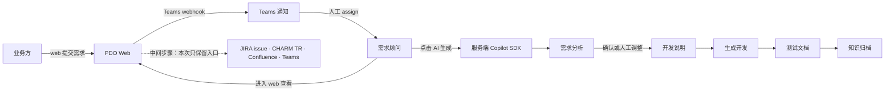
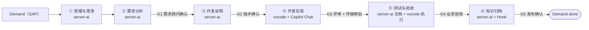

# PDO 现有流程 → 新架构映射与审视

> 依据：`docs/plan.md` 的原始简报、用户对 PDO 的口述，以及本仓库当前架构（[000-vision](../000-vision.md)、[002-architecture](../002-architecture.md)、[003-domain-and-protocol](../003-domain-and-protocol.md)、[004-sap](../004-sap.md)、[007-roadmap](../007-roadmap.md)）。
> **PDO 无本地代码**：本文不推断其内部实现，无法确认处写入 [5.2 开放问题](#52-开放问题需用户确认)。
> 标签：**【事实】** 用户已描述 ·**【推断】** 由描述与通用经验推出、需用户确认 ·**【建议】** 本文主张。
> 角色澄清（2026-11-05）：PDO 侧的核心执行角色是**需求顾问**（在 IT 与业务之间做需求分析/沟通），后文统一称需求顾问；业务方负责提出需求与最终验收。
> 范围：只做流程映射与设计审视；中间步骤只定义 Hook 契约、不实现；不涉及目录结构与 git 策略。

## 0. 结论先行

- 【推断】PDO 是「人工驱动的阶段文档流水线」，不是「工单式自主 agent」。它与新架构的差距不在 AI 能力，而在三处：**推进靠人点按钮、产物无版本与门禁、执行位置全在服务端**。
- 【建议】把 PDO 的「AI 生成 + 人工确认」重构成 **StageRun + Artifact 版本 + Gate**，而不是一个个按钮：9 个动作收敛为 6 个阶段，人工只做提交、确认/返工、开发、验收、发布五类动作。
- 【建议】PDO 的「服务端 AI」变成 `server-ai` 执行器；「VSCode 里 Copilot Chat 协作」变成 `vscode` 执行器。两者是同一 Task/StageRun 契约下的两种 Executor kind，共享 Artifact schema、门禁与审计，不做两套流程。
- 【建议】PDO 的「web 提需求 + Teams 通知 assign」换成「SAP Demand + 可领取池 + Presence/Lease」：人工任务只给在线且目录匹配的人，服务端 AI 阶段 7×24 自动推进。
- 【建议】JIRA / CHARM / Confluence / Teams 只做 HookTarget 契约（事件、payload、幂等键、重试、对账）；只有需要人确认的中间动作才升格为人工 Stage。
- 【推断】PDO 当前最薄弱的是**产物与状态的可信来源**：文档散落在 web 里，无法回答「这份测试文档基于哪版需求分析、谁改的、AI 还是人」。

## 1. PDO 现状重建

### 1.1 主链路【事实】



| # | 步骤【事实】 | 输入【事实】 | 执行者【事实】 | 产出物【事实】 | 失败/回退【推断/开放问题】 |
| --- | --- | --- | --- | --- | --- |
| 1 | web 提交需求 | 业务描述 | 业务方 | 需求记录 | 无受理校验，重复需求靠人看【推断】 |
| 2 | Teams webhook 通知并 assign 需求顾问 | 需求记录 | Teams + 人工 | 处理人（需求顾问） | webhook 无幂等/对账，被指派人离线则滞留【推断】 |
| 3 | 需求顾问进入 web 查看需求 | 需求记录 | 需求顾问 | — | 无上下文辅助，全靠人读【推断】 |
| 4 | 点击 AI 生成需求分析 | 需求记录 | 服务端 AI（手动触发） | 需求分析 | 超时/失败能否重试、是否覆盖旧版未知【开放问题】 |
| 5 | 确认或人工调整 | 需求分析 | 需求顾问（业务方会签可选） | 确认版需求分析 | 改动无版本与 diff 记录【推断】 |
| 6 | 生成开发说明 | 确认版需求分析 | 服务端 AI | 开发说明 | 基于哪版分析不明确【推断】 |
| 7 | 生成开发 | 开发说明 | 服务端 AI | 开发产出（形态未确认） | 产出形态未知——补丁/代码/文档？【开放问题】 |
| 8 | 生成测试文档 | 需求分析 + 开发 | 服务端 AI | 测试文档 | 与真实实现是否一致未知【推断】 |
| 9 | 知识归档 | 全链路文档 | 服务端 AI/人工 | 知识库条目 | 归档遗漏或版本不一致【推断】 |
| M | JIRA issue、CHARM TR、Confluence 归档 | 各阶段产出 | 服务端调用 | 外部单号 | 触发点与字段未确认；失败无重试语义【开放问题】 |

### 1.2 为什么值得换架构

| 痛点 | 具体表现 | 性质 |
| --- | --- | --- |
| 推进靠按钮 | 每步「点 AI 生成」→ 等人确认 → 再点下一步；无人时整条线停摆 | 推断 |
| 产物无版本 | 文档以最后一次覆盖为准，无法回滚、对比、追溯上游 | 推断 |
| 上游变化不级联 | 需求分析改了，开发说明/测试文档不会失效，仍按旧版推进 | 推断 |
| 推送式派单 | webhook + 人工 assign；人离线即任务滞留，无回池机制 | 推断 |
| 服务端缺代码上下文 | 生成开发拿不到仓库、SAP 对象、传输请求，落地与验证断层 | 推断 |
| 无授权与门禁模型 | 谁能触发哪步、谁能批准、AI 成本上限都没建模 | 推断 |
| 知识资产脱钩 | 产出物在 web 里，与代码库、Confluence 无稳定引用 | 推断/开放问题 |

## 2. 映射到新架构（需求—阶段—工件—门禁）

### 2.1 重建后的流水线【建议】



| 阶段 | 默认执行器 | 输入工件 | 输出工件 | 默认门禁 | 说明 |
| --- | --- | --- | --- | --- | --- |
| ① 受理与澄清 | server-ai | Demand 快照 | 受理结论 + 澄清问题 | 无（澄清回 SAP/Fiori 待办） | PDO 没有此阶段；补它是为了过滤不完整需求 |
| ② 需求分析 | server-ai + vscode 精修 | ① 结论 | `requirement_analysis` | G1 需求顾问确认 | PDO「AI 生成 + 确认调整」归位到此 |
| ③ 开发说明 | server-ai | ② approved 版本 | `dev_spec` | G2 技术确认 | 可配置并入 G3，减少一次审批 |
| ④ 开发实现 | vscode | ③ approved 版本 | `code_change` + 链接 | G3 评审 + TR 审批 | PDO「生成开发」必须落到客户端 |
| ⑤ 测试与验收 | server-ai + vscode | ②③④ | `test_doc` + 执行证据 | G4 业务验收 | 文档由 AI 生成；测试执行由 vscode 任务或人工完成并留证据 |
| ⑥ 知识归档 | server-ai | 全部 approved 工件 | `knowledge_entry` | G5 发布确认 | 归档经 Confluence Hook 发布 |

关键取舍【建议】：

- 「点击 AI 生成」「确认/调整」不是阶段，而是 StageRun 执行 + Gate 决策；这就是 9 步收敛为 6 阶段的原因。
- 「进入 web 查看」= 客户端拉上下文包（`GET /tasks/{id}/context`），不占阶段。
- 「Teams 通知 + assign」= `task.offered` / `claim` + Lease，不占阶段。
- 门禁数量是「简洁」的主要旋钮：默认 5 个，最小可保留 G1、G3、G4（与 [007-roadmap](../007-roadmap.md) 的「人工介入 ≤3 次/需求」目标一致）；合并方案写进阶段模板，不写死在代码里。

### 2.2 PDO 步骤逐项映射【建议（输入为用户事实）】

| PDO 步骤 | 落点：实体 / 状态 / 工件 / 门禁 | 控制平面做 | VSCode 客户端做 | 服务端 AI 做 |
| --- | --- | --- | --- | --- |
| web 提需求 | `Demand.submitted`；受理 StageRun | 建 Demand、查重、触发 ① | — | 分类/补全建议（①内） |
| Teams 通知 assign | `Task.pending→offered→claimed`；Presence/Lease | 资格匹配、推送 `task.offered`、超时回池 | 接收提示、`claim` + 续约 | — |
| 进入 web 查看 | 上下文包（Markdown + JSON） | 提供只读快照 | 打开目录、上下文注入 Copilot Chat | — |
| 点击生成需求分析 | StageRun(②)；`Artifact(requirement_analysis, draft)` | 自动触发、排队、重试、schema 校验 | 可查看、可精修 | 生成初稿 |
| 确认/人工调整 | `Approval(approved)` + 新 Artifact 版本 | 记录版本与审批、推进阶段 | Copilot Chat 精修 + 人工编辑；业务方确认在 SAP 内完成 | 按新版本可选重生成 |
| 生成开发说明 | StageRun(③)；`Artifact(dev_spec)` | 自动触发、绑定上游版本 | 可评审补充 | 生成结构化说明 |
| 生成开发 | StageRun(④)；Task(coding)；`Artifact(code_change)` | 建任务/worktree、租约、回写 | Copilot Chat + 本地仓库 + abap-cli + TR | 不参与（只读建议可选） |
| 生成测试文档 | StageRun(⑤)；`Artifact(test_doc)` | 自动触发；登记执行证据 | 执行 ABAP Unit/手工测试并提交证据 | 生成测试文档 |
| 知识归档 | StageRun(⑥)；`Artifact(knowledge_entry)`；Confluence Hook | 触发归档、Hook 出站 | 可选审阅 | 生成知识摘要 |
| JIRA issue | `HookTarget(jira)`；外部 ID 存 Artifact.links | outbox + 幂等 + 对账 | — | — |
| CHARM TR | `HookTarget(charm)` + 传输审批门禁 | 门禁后触发、TR 号回写 | 必要时填写/确认 | 生成 TR 描述草稿 |
| Confluence 归档 | `HookTarget(confluence)` | upsert + 对账 | — | 摘要已在 ⑥ 产出 |
| Teams 通知 | `HookTarget(teams)` / 通知通道 | 出站通知 | 展示 | — |

### 2.3 三种执行方式的边界【建议】

| 工作项 | 服务端 AI | VSCode Copilot Chat | 必须人工 | 判据 |
| --- | --- | --- | --- | --- |
| 需求分类/查重/补全 | 适合 | 可选 | 否 | 只读文本、低风险、可批量 |
| 需求分析初稿 | 适合 | 适合精修 | G1 确认 | 依赖需求文本；精修需要上下文 |
| 开发说明 | 适合 | 适合补充 | G2 确认 | 结构化生成；可先检索规范/代码摘要 |
| 代码实现 | 不适合 | 必须 | G3 评审 + 传输审批 | 需本地仓库、SAP 连接、编译激活闭环 |
| 测试文档 | 适合 | 适合补充 | 执行与 G4 验收 | 文档生成与真实测试执行必须分开 |
| 知识归档 | 适合 | 可选 | G5 发布确认 | 汇总类；组织知识发布需人负责 |
| 通知/派单/状态推进 | 不做 | 不做 | 否 | 确定性逻辑，不进模型 |
| 主动巡检（停滞/相似需求） | 适合（observe） | 否 | 候选接受才动作 | 判断类、易误报，需保守 |

三条边界原则【建议】：

- **数据边界**：代码、SAP 连接、凭据只在客户端；服务端 AI 只处理需求与工件。若需要代码上下文，由客户端生成摘要/片段后再上传。
- **权威边界**：业务状态在 SAP，执行态在控制平面，工作区在客户端；三者用 ID 关联、不互写真相（沿用 [000-vision](../000-vision.md) 原则 3）。
- **审计边界**：每个 Artifact 记录来源（`ai`/`human`/`agent`）、执行器、模型/prompt 版本、上游工件版本、checksum、审批记录。

补充：**业务方（需求方、审批人）不装 VSCode**。他们的提交、确认、验收在 SAP/Fiori 内完成，以 `Approval` 驱动阶段；VSCode 只承载开发类人工任务（领取、开发、测试执行）。这决定了两条人工通道不能混：客户端做不了业务审批，SAP 待办也做不了代码工作。

### 2.4 PDO 没有、新架构必须补的两件事【建议】

- **主动推进**：阶段依赖满足即自动执行，人只在 Gate 出现；PDO 的「点按钮」消失，这正是用户提的「主动处理」。
- **离线不派单**：人工任务靠 Presence + `claim` + Lease 派发，服务端 AI 阶段不看在线状态；PDO 的推送式 webhook 派单退役。

## 3. 中间步骤的 Hook 契约（只定义，不实现）

> 注：本节写于 [008-hooks.md](../008-hooks.md) 之前，仅保留分析视角；**权威契约以 008 为准**，字段冲突时按 008 修改本节。

### 3.1 契约原则【建议】

- 复用 [003-domain-and-protocol](../003-domain-and-protocol.md) §6 的 `HookTarget`（`event` / `payload` / `send` / `idempotencyKey`）与 §4.1 的幂等、重试约定；出站走 Hook 出站队列（outbox），入站走 SAP webhook（HMAC + `X-SA-Delivery`）。
- Hook 绑定到阶段事件（`stage_done` / `gate_resolved` / `demand_state_changed`），默认不建模成新 Stage；**只有需要人工确认的中间动作**（如 CHARM 传输审批）才升格为人工 Task 或 Gate，再触发 Hook。
- 幂等键 = 业务键 + Hook 类型 + 稳定输入 hash；外部系统返回的外部 ID（JIRA key、TR 号、page id）回写 Artifact/Event，作为对账依据。
- 失败分 transient（5xx/网络/429 → 退避重试）与 permanent（4xx 校验失败 → 死信 + 人工可见）；禁止静默丢弃；每个 Hook 声明对账方式。

### 3.2 统一信封【建议】

```json
{
  "eventId": "01J...",
  "eventType": "hook.jira.issue.ensure",
  "occurredAt": "2026-11-04T12:00:00Z",
  "subject": { "demandId": "01J...", "stageRunId": "01J...", "artifactId": "01J...", "version": 2 },
  "payload": {},
  "idempotencyKey": "<demandId>:<hook>:<sha256(stableInputs)>",
  "retry": { "maxAttempts": 5, "backoff": "exponential", "deadLetter": true },
  "traceId": "..."
}
```

### 3.3 四个 Hook 的契约【建议】

| Hook | 方向 | 触发点（建议） | payload 关键字段 | 幂等键 | 重试 / 失败 / 对账 |
| --- | --- | --- | --- | --- | --- |
| JIRA issue | 出站 | ②/③ 门禁通过后建 issue | `project` `issueType` `summary` `descriptionRef` `priority` `demandId` | `demandId:jira:<templateVersion>:<sha256(analysis)>` | 先查后建；5xx 退避；4xx 死信；每日对账 |
| CHARM TR | 出站 | G2/G3 通过后建 TR | `targetSystem` `client` `owner` `descriptionRef` `artifacts` `demandId` | `demandId:charm:<targetSystem>:<sha256(code_change)>` | 非幂等 → 先查后建 + 人工兜底；TR 号回写；失败转人工 Task |
| Confluence 归档 | 出站 | ⑥ 归档 Stage done | `space` `parent` `title` `bodyRef` `labels` `demandId` | `demandId:confluence:<pageKey>:<version>` | upsert 可安全重试；发布前 Gate G5 |
| Teams 通知 | 出站 | 待人工任务/门禁/超时 | `channel` `template` `demandId` `deepLink` `mention` | `eventId` + `demandId:teams:<template>` | 通知可丢（TTL 后放弃）但审计保留；429 按 `Retry-After`；PDO 遗留通道，默认由 SAP 内通知替代（[004-sap](../004-sap.md) §4） |
| SAP 回写 | 出站 | 每次阶段/门禁变化 | `demandId` `status` `artifactRef` `approvalResult` | `demandId:writeback:<version>` | 乐观并发 `If-Match`；409 重拉后重放；每日对账 |
| 外部回执 | 入站 | JIRA/CHARM 完成 | `externalId` `status` `demandId` `assignmentId` | `X-SA-Delivery`（SAP 转发时）或 `externalId+status` | 入站幂等；丢失靠按 `externalId` 对账 |

### 3.4 失败语义速查【建议】

- transient：指数退避；控制平面出站建议 2s 起、上限 5m、最多 5 次，SAP 侧 outbox 按 [004-sap](../004-sap.md) §3.3 的 1s/5s/30s/5min/30min（24h 后 `DEAD`），阶段不因此失败。
- permanent：写死信 + 通知负责人；对应的中间动作在需求时间线可见，由人手动标记完成或跳过。
- 非幂等外部动作（CHARM TR）：先按业务键查询，再创建；仍未定时转人工，不做自动重试。
- 回执丢失：对账任务按外部 ID 查询修复，不重放创建动作。
- 阶段被取消：未发送的 Hook 标记 `cancelled`；已发送的尝试补一条关闭/留言动作。

## 4. 概念对齐与最小概念集

### 4.1 dsh-superagent 概念 → 本项目的处置

| dsh-superagent 概念 | 本项目落点 | 处置 |
| --- | --- | --- |
| Source / Trigger / Channel | SAP SourceAdapter、Event、Hook | 复用思想，换实现 |
| Thread / Subscription / Correlation | 无对应：需求系统自己承载评论与通知 | 删除 |
| Eval / Decision / Assessment（模型判断接不接单） | 无对应：阶段由模板确定性推进 | v1 删除，未来做主动巡检时再加 |
| Policy / Mandate / Policy version / revalidation | 阶段模板、Gate 规则、角色映射 | 简化（不做 Mandate 作用域与重校验链） |
| Ticket | `Task`（可指派工作单元）+ `StageRun`（阶段执行记录） | 拆分复用 |
| Assignment | `Assignment` + Lease | 保留并加租约 |
| Report / Attention | Task 事件 + `question` / `waiting_human` | 复用 |
| Effects / Outbox | Hook 出站队列 + 事件日志 | 直接沿用机制 |
| Panel / DSH Session | VSCode 扩展 + Copilot Chat | 替换 |
| Executor Session / worktree / worker slot | VSCode 工作区/worktree + 调度规则 | 替换并简化 |
| 多 Source 插件体系 / admission table | 单一 SAP SourceAdapter（v1） | 简化 |

### 4.2 最小概念集【建议】

结论：**6 个业务概念 + 3 个支撑对象 + 3 个运行时属性**足够覆盖 PDO，不再引入 dsh 的 Thread/Eval/Mandate/Subscription。

- 6 个业务概念：Demand、Stage、Task、Assignment、Artifact、Gate/Approval。
- 3 个支撑对象：Executor、Hook、Event（审计流水就是 Event，不单列）。
- 3 个运行时属性：Presence、Lease、Workspace。
- 比 dsh 少：多 Source 插件体系、Thread/订阅/fan-out、模型 Eval 决策链、Mandate basis/revalidation、PR 跟单、DSH worker slot。
- 比 dsh 多：Stage/StageRun 模板与流水线（一等公民）、Artifact 版本链、Approval/门禁、Presence/Lease/Workspace、server-ai 执行器、HookTarget。
- 两个不能合并的区分：`Stage`（模板声明，无状态）vs `StageRun`（实例与状态机）；`Gate`（模板规则）vs `Approval`（待办与决策记录）。Demand 不存进度，进度由 StageRun 聚合（与 [003-domain-and-protocol](../003-domain-and-protocol.md) §2.1 一致）。

## 5. 风险与开放问题

### 5.1 风险【建议】

| 风险 | 表现 | 建议 |
| --- | --- | --- |
| 双系统状态漂移 | 审批在 SAP、任务在控制平面，回写失败即分叉 | 业务状态以 SAP 为准、执行态以控制平面为准；版本 CAS 回写 + 每日对账 |
| 两个 AI 通道产物不一致 | 服务端 AI 与 Copilot Chat 生成的同名工件风格/质量不一 | 统一 Artifact schema + schema 校验；记录 executor/模型/prompt 版本 |
| 数据外发合规 | 服务端 AI 看到 SAP 代码或业务数据 | 代码与凭据不出客户端；服务端只拿需求与工件摘要 |
| AI 成本失控 | 每阶段重复生成、Copilot premium requests 无上限 | 按需求/阶段预算上限；先检索/缓存再生成；失败重试有上限 |
| 审计不可追溯 | 无法回答「这段是 AI 写的还是人写的、据哪版需求」 | Artifact 记来源/上游版本/checksum；审批记人与时间 |
| 门禁形式化 | 审批人直接点通过，门禁失去意义 | 门禁展示上游 diff 与 checklist；记录审批意见与耗时 |
| 租约边界 | 领了不干、重复领取、跨目录领取 | 租约 60s + 续约 + 过期回池；claim 原子；资格规则确定性 |
| 主动巡检误报 | 提醒噪声多，消耗注意力 | 默认 observe（只记录建议）；候选合并去重；接 dsh「注意力最小化」原则 |
| SAP 宿主（M3）受限 | ABAP 侧不适合跑完整 agent 主循环 | SAP 只做需求系统 + 审批 + 批处理 AI 阶段；控制平面外置（见 [002-architecture](../002-architecture.md) §2） |

### 5.2 开放问题（需用户确认）

1. PDO 里「需求分析确认」之外的阶段（开发说明、测试文档）是否也有人工确认？确认人分别是谁？
2. 「生成开发」的实际产出是什么：代码建议、直接改 SAP 对象、还是文档？这决定 ④ 阶段的完成标准与门禁强度。
3. PDO 的人工调整是覆盖式编辑还是保留历史版本？若一直是覆盖，迁移时需要重建基线。
4. 需求受理/驳回是否存在？谁有权把需求放进 AI 流水线（新架构 ① 阶段的依据）？
5. 「在 SAP 内搭建需求系统」的范围：自建 Z 表/RAP 对象，还是复用标准 PM/CRM 对象？影响 Demand 字段与事件契约。
6. JIRA / CHARM / Confluence 的真实触发点、必填字段与幂等依据（是否已有外部 ID 可回写）？
7. 服务端 AI 可用的模型与数据边界：需求文本能否出 SAP？代码是否永远不出域？
8. 离线场景细节：一个开发者是否需要跨团队/跨目录接任务？「打开特定目录自动获取任务」是否一一对应？
9. PDO 的历史需求、文档与知识库如何迁移：只迁 open 需求，还是全量只读归档？

## 6. 对用户方案最需要改的 3 个设计点

1. **把「AI 生成」从按钮改成阶段执行。** PDO 的主循环是人点按钮→AI 生成→人确认；新架构应让 StageRun 在依赖满足时自动执行，人只在 Gate 出现。否则即使换了架构，主动推进也只是换个地方点按钮。
2. **把两个 AI 入口统一成执行器契约。** 服务端 Copilot SDK 与 VSCode Copilot Chat 应共用 Task/StageRun、Artifact schema、门禁与审计，只是 `kind` 不同。否则会出现两套产物、两套状态，无法对账，也无法回答「最终交付的这份文档是哪条通道生成的」。
3. **把推送式派单和外部系统硬编码改成「拉式领取 + Hook 契约」。** 人工任务必须让客户端凭资格 `claim` 并持租约（离线不派单、过期回池）；JIRA/CHARM/Confluence/Teams 只定义事件、payload、幂等键、重试与对账，不进入阶段图。否则 webhook 丢失、重复建单、TR 重复创建这些问题会一直存在。

## 参考

- [plan.md](../plan.md)：用户原始简报与 PDO 描述。
- [000-vision.md](../000-vision.md)、[002-architecture.md](../002-architecture.md)、[003-domain-and-protocol.md](../003-domain-and-protocol.md)：当前目标架构与领域概念。
- [004-sap.md](../004-sap.md)、[007-roadmap.md](../007-roadmap.md)：SAP 侧边界、outbox 退避与验收指标。
- DeepSeek dsh-superagent 原型 `docs/001-domain.md`、`docs/003-execution.md`、`docs/007-architecture.md`：Source/Trigger/Thread/Eval/Ticket/Mandate/Assignment/Channel、Effects/Outbox 与 Ticket 阶段（只读参考）。
